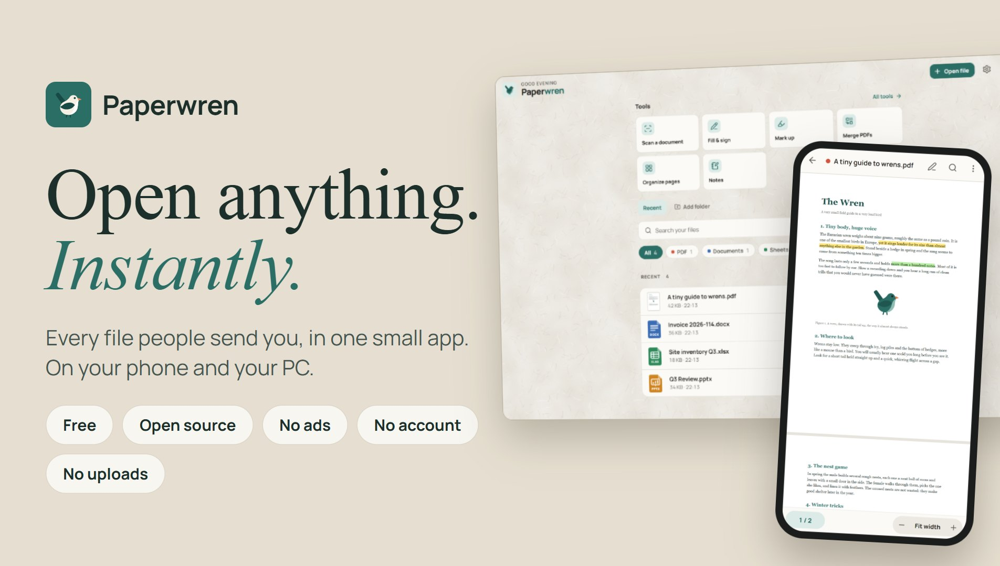
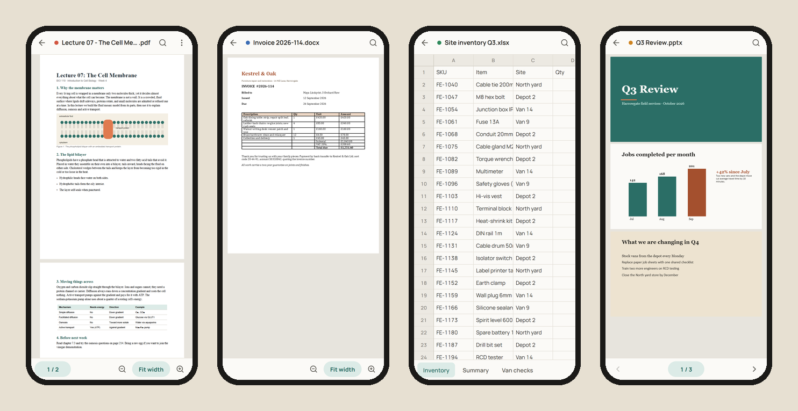
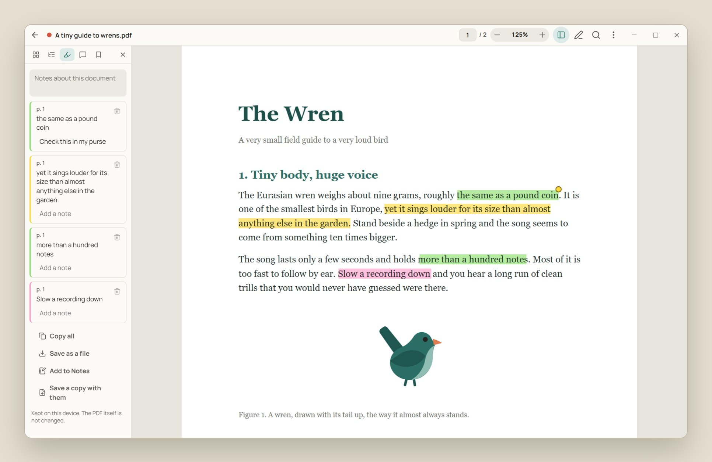
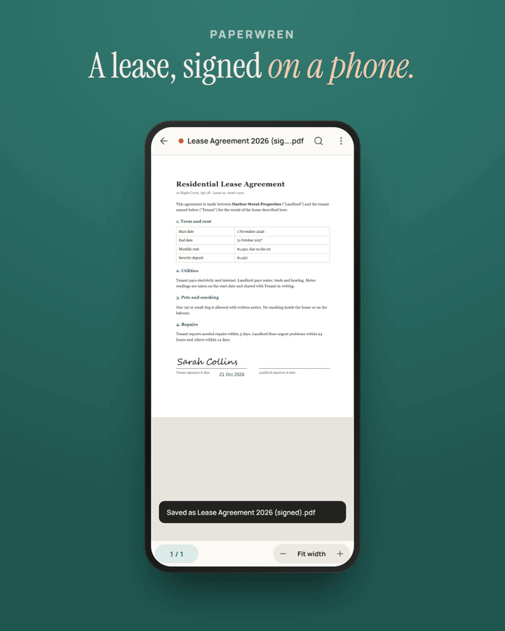
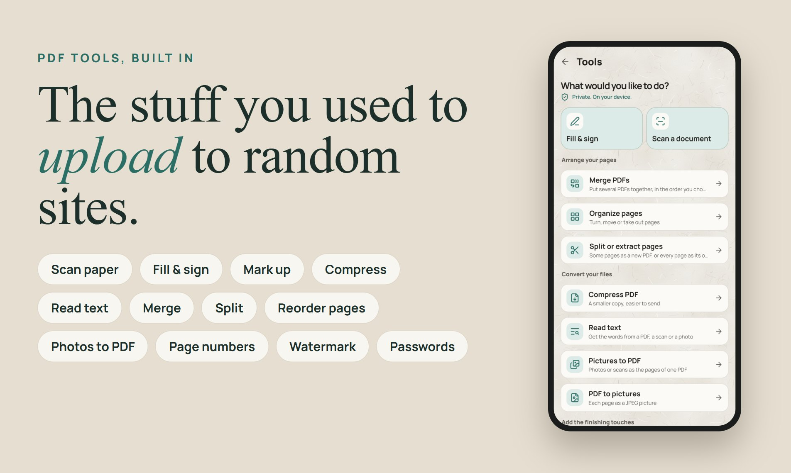
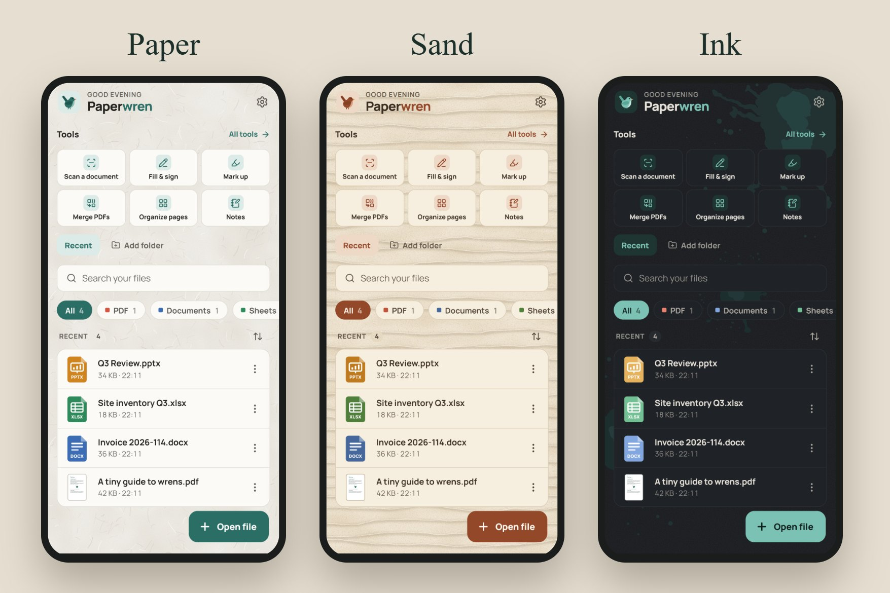

<p align="center">
  
</p>

<p align="center">
  <a href="https://github.com/Razee4315/Paperwren/releases/latest"><strong>Download</strong></a> ·
  <a href="https://razee4315.github.io/Paperwren/">Website</a> ·
  <a href="docs/features.md">Everything it does</a> ·
  <a href="https://razee4315.github.io/Paperwren/privacy">Privacy</a>
</p>

<p align="center">
  <a href="https://github.com/Razee4315/Paperwren/releases/latest"></a>
  <a href="https://github.com/Razee4315/Paperwren/releases"></a>
  <a href="https://github.com/Razee4315/Paperwren/actions/workflows/ci.yml"></a>
  <a href="LICENSE"></a>
</p>

Your boss sends a Word file. Your landlord sends a PDF to sign. A friend sends a comic book, for some reason. Paperwren opens all of them, fast, on Android, Windows and Mac.

It's named after a wren: a bird that weighs about as much as a coin and is far louder than it has any right to be. Same idea here: a small app that does far more than you'd expect. No ads, no account, and your files never leave your device.

## Get it

Grab the file for your device from the [latest release](https://github.com/Razee4315/Paperwren/releases/latest).

| Device | File | Good to know |
|---|---|---|
| Windows 10 and 11 | `Paperwren_<version>_x64-setup.exe` or `.msi` | Double-click a document and it just opens |
| Mac, Apple silicon or Intel | `Paperwren_<version>_universal.dmg` | Apple hasn't notarized it, so the first time, go to System Settings, Privacy & Security, and press Open Anyway |
| Android 8 and later | `Paperwren-v<version>-android.apk` | Use "Open with" from any app, or share a file into it |

## It opens the stuff people send you



PDF, Word, Excel, PowerPoint, OpenDocument, RTF, EPUB, CSV, Markdown, plain text, source code, comic books and pictures. Those old `.doc`, `.xls` and `.ppt` files too, the ones nobody wants to deal with.

Got a file with the wrong name or no extension at all? Paperwren looks inside the file, so it still opens in the right viewer.

## Scribble while you read



Select some words and tap a colour. That's it, there's no Save button. Underline, strike out, leave yourself a note. Your marks stay on your device, they follow the PDF if you rename or move it, and the file itself is never touched.

When you're done, copy everything as Markdown, send it to Notes, or save a PDF copy with the marks in it.

## Sign things without a printer



Type your name, draw it, or upload a photo of your signature. Drop it on the page with the date, a tick, or a stamp that says PAID.

Forms work too. Type into the fields, tick the boxes, done.

Save a copy, send it off, and get on with your day. No printing, no scanning, no "free trial" that wants your card number.

<br clear="right" />

## Every PDF job, right on your device



| You have | You want |
|---|---|
| A pile of paper | **Scan a document**: a straight, clean PDF from your phone's camera |
| A plan or a draft to check | **Mark up**: draw, write, highlight, even measure lengths on a plan |
| A PDF too big to email | **Compress PDF** |
| A scan you can't copy from | **Read text**: pulls out the words in nine languages, right on your device |
| Five PDFs that should be one | **Merge PDFs** |
| One PDF that should be five | **Split or extract pages** |
| Pages in the wrong order | **Organize pages** |
| Photos for a form | **Pictures to PDF**, and PDF to pictures for the trip back |
| A finishing touch | **Page numbers**, a **watermark**, or a **password** |

Every tool saves a new file where you choose. Your original stays exactly as it was.

## Also hiding in there

- **Notes**, typed or handwritten, all searchable
- **Read aloud** with your device's own voices
- **Presenter view and a laser pointer** for slide decks
- **Tabs** on Windows, one per document
- **Volume keys** that turn pages on your phone
- **Nine languages**: English, 中文, हिन्दी, Español, Français, Português, Русский, العربية and اردو

There's a lot more. [Here's the full list](docs/features.md), and yes, it's long.

## Pick a mood



Three themes made for long reading. Auto gives you Paper by day and Ink at night.

## Your files are your business

- No analytics, no account, no ads.
- The Android app has no network access and asks for zero permissions. The release build fails if one sneaks in.
- Windows and Mac ask once whether to check for updates. Say yes and Paperwren asks GitHub for a new version. Nothing about you or your files goes with it.
- It never changes a file you open. The one exception is Rename, when you ask for it.

Read the [full privacy policy](https://razee4315.github.io/Paperwren/privacy).

## Build it yourself

You need Node 20 or newer.

```bash
npm install
npm run dev
```

That gives you a web preview at http://localhost:1420. Tests, architecture, translations and releases are all in the [development guide](docs/development.md). The translations had no native reviewer, so fixes are very welcome.

## License

MIT. Bundled libraries keep their own licenses, listed in the app under Settings, About.
