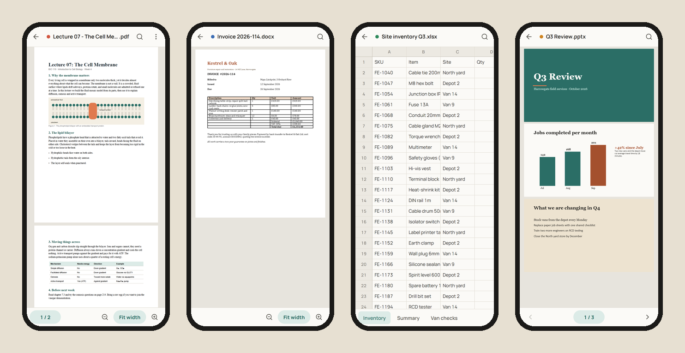
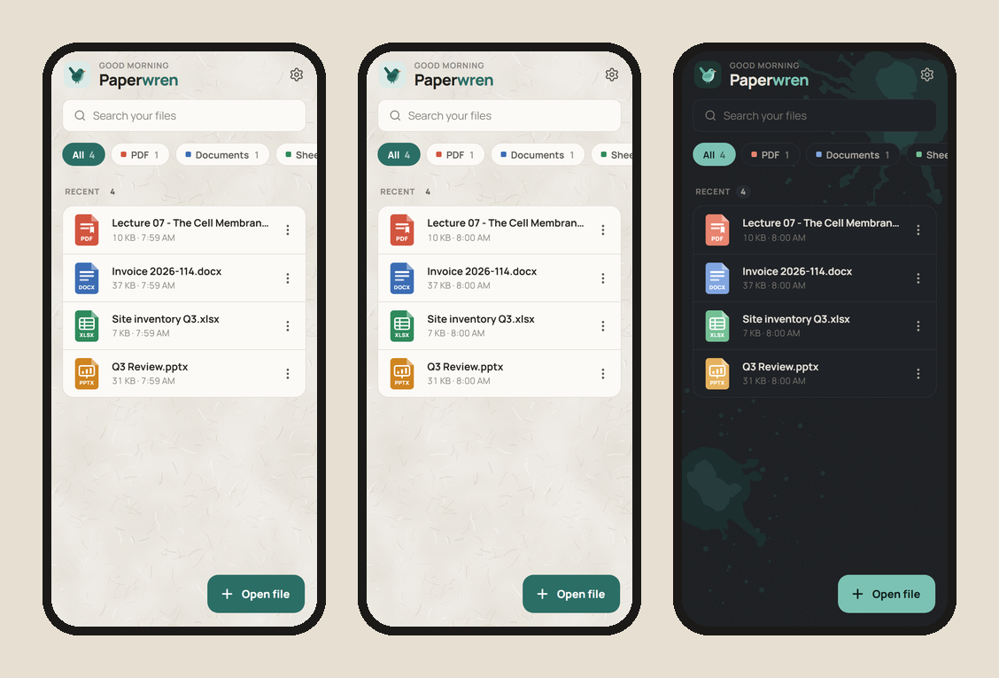
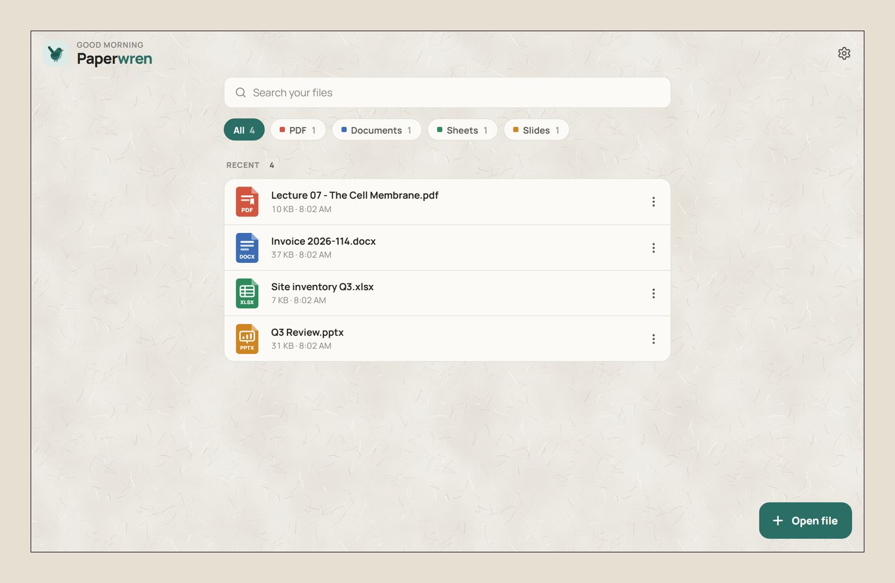

<p align="center">
  
</p>

<h1 align="center">Paperwren</h1>

<p align="center"><strong>Open anything. Instantly.</strong></p>

<p align="center">
  A small, fast document viewer for Android, Windows and macOS.<br />
  No ads, no accounts, no permissions. Offline, but for an update check you allow.
</p>

<p align="center">
  <a href="https://github.com/Razee4315/Paperwren/releases/latest">Download</a> ·
  <a href="https://razee4315.github.io/Paperwren/">Website</a> ·
  <a href="https://razee4315.github.io/Paperwren/privacy">Privacy</a>
</p>

<p align="center">
  <a href="https://github.com/Razee4315/Paperwren/releases/latest"></a>
  <a href="https://github.com/Razee4315/Paperwren/releases"></a>
  <a href="https://github.com/Razee4315/Paperwren/actions/workflows/ci.yml"></a>
  <a href="LICENSE"></a>
</p>



Paperwren opens PDF, Word, Excel, PowerPoint, OpenDocument, RTF, EPUB, CSV, Markdown and plain-text files, source code, comic books and pictures. It also fills in, signs and marks up PDFs, compresses, merges, splits and organizes them, each tool saving a new copy, and it keeps notes you type or write by hand. Everything happens on the device. The Android app never touches the network and requests zero permissions; on Windows and macOS the only thing Paperwren ever fetches is a new version of itself, and only if you allow it.

## Contents

- [Download](#download)
- [What it opens](#what-it-opens)
- [Around the document](#around-the-document)
- [Tools](#tools)
- [Notes](#notes)
- [On Windows](#on-windows)
- [On a Mac](#on-a-mac)
- [Zoom and keyboard](#zoom-and-keyboard)
- [Look and feel](#look-and-feel)
- [Privacy](#privacy)
- [Development](#development)
- [Architecture](#architecture)
- [Builds and releases](#builds-and-releases)
- [License](#license)

## Download

Every release is on the [releases page](https://github.com/Razee4315/Paperwren/releases/latest).

| Platform | File | Notes |
|---|---|---|
| Windows 10 and 11, 64-bit | `Paperwren_<version>_x64-setup.exe` or `Paperwren_<version>_x64_en-US.msi` | Registers Paperwren for the document types it opens. Drop a file on the window, double-click one, or press Ctrl+O |
| macOS, Apple silicon and Intel | `Paperwren_<version>_universal.dmg` | Drag Paperwren into Applications. It is not notarized by Apple, so the first time macOS declines to open it: allow it in System Settings, under Privacy & Security, with Open Anyway |
| Android 8.0 and later | `Paperwren-v<version>-android.apk` | One universal APK. Open a file from any app with "Open with", share one into Paperwren, or pick one inside it |

## What it opens

| Format | How it is shown |
|---|---|
| PDF | pdf.js viewer: fast virtualised pages, text selection, find with highlights, contents, rotate, two pages side by side, password-protected files. Its character maps and standard fonts ship with the app, so Chinese, Japanese and Korean files that name a font without carrying it still read. Go to a page by number (or by the document's own label, such as "iv"), pick one from the page thumbnails, or drag the handle on the right edge. A form is shown as it was saved; nothing can be typed into it and lost. A long file asks which pages to print before it draws any. Pages can turn sideways, one (or two) at a time, by swipe, wheel or a tap on either side. **Crop margins** trims the empty edges every page shares. A link to another page leaves a "Back to page n" chip, and Back and Alt+Right walk that trail. The side panel lists a file's comments and highlights, its attached files (which open in the app) and its layers, which can be switched off. Details give the page size, the PDF version and whether its author forbids copying |
| Word `.docx` | The document's own page layout (docx-preview), fit to width, find, "3 / 12" page counter and go to page, and a list of its headings to jump by. **Reading view** lets the text flow to the width of the screen instead, for a phone. Comments can be shown when a document has them. Long documents only lay out the pages near the screen. Details show its title, author, dates, who changed it last and its word count, for every Office and OpenDocument file |
| Excel `.xlsx` `.xlsm` `.xlsb`, `.xls`, `.ods`, `.csv` `.tsv` | Virtualised grid: frozen rows and columns, merged cells, sheet tabs, find across every sheet, go to a cell by its address, zoom that keeps the headers pinned. Select a range (drag, shift-click, or the corner grip on touch) to copy it and see its sum, average and count. Drag a column edge to resize, double-click to fit. `.xlsx` cells keep their bold/italic, text colours, fills, borders and alignment; long text runs over empty neighbours; charts and pictures on a sheet are drawn where the file puts them. A cell's link and its note are shown beside the cell. Sheets a workbook hides stay hidden, and so do the gridlines of a sheet drawn without them (a switch brings them back). **Conditional formatting** is applied to the values the file saved: highlight rules that compare with a number or text, text rules, and colour scales. A column can be **sorted or filtered** for reading; the file is not changed, the header stays put and each row keeps its address. A CSV can be read in another text encoding |
| PowerPoint `.pptx` | Slides drawn from their own shapes, theme colours, layouts, freeform outlines, gradients, shadows, cropped pictures and tables, plus speaker notes. Bar, line, area, pie, doughnut and scatter charts are drawn from the numbers stored in the file; SmartArt is drawn from the shapes the file saved for it. Jump to a slide by its number or pick it from a grid of small slides. The slide show takes the whole screen, one slide at a time (on a phone it hides the status bar and turns the screen sideways): swipe, tap a side, click, or use the arrow keys; it passes over slides the author hid, and can show the speaker notes. **Presenter view** (P) shows the slide, the next one, the notes, a stopwatch and the time; the **laser pointer** (L) turns the pointer or a finger into a red dot |
| Books `.epub` | Chapters in one flowing column in a reading face, with the book's contents, its pictures, footnote links, find, bookmarks and read aloud. A book locked by its store (DRM) says so instead of showing nonsense |
| Legacy `.doc`, OpenDocument `.odt` | A flowing document with its formatting, lists, tables and pictures (the page layout is not reproduced, and the viewer says so). Word 6/95 files and `.rtf` show their text |
| Legacy `.ppt`, OpenDocument `.odp` | Drawn as slides, like `.pptx`: shapes, text, pictures, tables and backgrounds |
| Markdown, text, logs, JSON, XML, source code | Rendered Markdown (sanitised; its source is a tap away) with a list of its headings and TeX maths (`$…$`, `$$…$$`) drawn by KaTeX, or plain text with encoding detection. Source code in some thirty languages has its syntax coloured. JSON opens as a tree that folds, keeping every digit and repeated key; XML written on one line is laid out for reading. Long lines wrap or keep their length, and lines can be numbered. A script is shown, never run or handed to another app |
| Pictures `.png` `.jpg` `.gif` `.webp` `.bmp` `.svg` `.avif` `.heic` `.tif` | Fitted to the screen, zoomable, and turned the right way up when taken sideways: a scan or a photo of a page is a document too. A multi-page TIFF turns its pages; arrows step through the other pictures in the folder; a picture can be turned or flipped. Details show the camera, the lens, when and how it was taken. An SVG's scripts never run. Android draws HEIC photos the webview cannot |
| Comic books `.cbz` | Its pages in order, one at a time, by swipe, tap or key, remembered where you stopped |

Password-protected `.docx`, `.xlsx` and `.pptx` files open with their password (both the Office 2007 and the Office 2010+ encryption). The password is used in memory, once, and never stored. Protected `.doc`/`.xls`/`.ppt` files, and files locked with a certificate or rights management, are not opened; the app says so.

Right-to-left text (Arabic, Urdu, Hebrew) reads from the right in slides, documents, text files and sheet cells, whether or not the file says so.

The bytes decide the format, not the file name: content URIs without extensions and files with the wrong extension still open in the right viewer.

## Around the document

- **The file menu** in every viewer: share (or save a copy), open in another app, show in folder, print, details. What a platform cannot do is left out rather than greyed out.
- **Print** lays the whole document out again for paper, including pages that were never scrolled into view.
- **Folders**: pick a folder on Home to browse the documents inside it, with the same search and type filters as recents.
- **Large files**: a file big enough to be slow, or to be more than a phone can hold, asks before it is read. A sheet with more cells than can be held is shown up to its last whole row that fits, and says so.
- **Links** in a document are never followed (the app has no network access): a link within the document scrolls to its target, and a web or mail address is shown so it can be copied.
- **Bookmarks**: Ctrl+D (or the menu) marks the place, named after its page, slide or the words at the top of the screen; they are listed in the menu and the side panel, per file.
- **Read aloud** with the device's own voices (only those that work offline), sentence by sentence with the words highlighted, at the pace chosen. It starts where you are reading.
- **Page colour**: original, sepia, dark or the theme's own paper, for PDFs, documents and books; the pictures in a page keep their colours.
- **Reading font**: books, Markdown and reading view as written, in a serif or in a sans serif.
- **On a phone**: turn pages with the volume keys or a tap on the edges of the screen, let the bars step aside while reading, dim the screen further than its own lowest brightness, or let the document scroll by itself.
- **Find** can match case and whole words.
- **Recents** can be sorted by last opened, name or size; removing one, clearing them or turning them off can be undone for a few seconds. A file reopens at the page and zoom it was left at.
- **Keep the screen on** while a document is open (off by default; no permission needed).
- **Languages**: English, 中文, हिन्दी, Español, Français, Português (Brasil), Русский, العربية and اردو, following the phone or chosen in Settings. Arabic and Urdu mirror the app; documents keep their own direction. See "Translations" below.

## Tools

The PDF jobs people otherwise upload to a website for, on the device. Open them from **Tools** on Home, from a PDF's menu (**Fill & sign**, **Mark up**, **More PDF tools**), or from a photo's (**Scan this photo**). Each tool saves a new file where you choose, in the system's own save screen; the files you started with are not changed.

| Tool | What it does |
|---|---|
| Scan a document | Paper to a PDF. Take a photo with the phone's camera, or choose photos already taken (several at once). The page's edges are found by themselves and can be dragged into place, with a magnifier beside the finger; the page is straightened, then given a look: clean (the paper made evenly white, shadows and colour casts taken out), the original, grey, or black & white, and turned if need be. Pages are reordered, changed or removed, then saved together, as scanned or on A4 or Letter. A small "Scanned with Paperwren" line at the foot of each page goes with one switch, and stays off |
| Fill & sign | The form's own fields can be typed into, ticked and chosen. Anywhere on a page you can put a signature or initials, a stamp, a line of text, the date, a tick or a cross, and move, resize or remove them; a signature field in the form is a "Sign here" box. A signature is drawn with a finger, pen or mouse, typed in a handwriting face, or uploaded: a PNG with a clear background is used as it is, a photo of one on paper has its paper made clear. A stamp is made from words (APPROVED, PAID or your own) in red, blue, green or black, square or round, with the date if wanted, or uploaded as a PNG or a scan. Signatures and stamps can be kept on the device for next time. The copy keeps the fields as fields, or makes them part of the page. Marks stay upright on pages the file turns, and text in a script the standard PDF fonts lack is drawn as a picture. A PDF whose author forbids changes says so instead |
| Mark up | Write and draw on the pages with a finger, stylus or mouse, in a colour and thickness you choose. A felt marker colours over anything; **Highlight text**, **Underline** and **Strike out** follow the words as you drag across them. Notes sit where you tap. An eraser, undo and redo. One finger writes and two scroll and zoom; once a stylus touches the page, a finger only scrolls. The marks are saved as the PDF's own annotations, so other apps can show, list, change or remove them. A PDF whose author forbids changes says so instead |
| Compress PDF | A smaller copy: its pictures stored again at the quality you choose, and only where that saves something. Text stays text, and what a JPEG would change (masks, CMYK and palette pictures) is left alone. If a file cannot get smaller, no copy is made and the app says so |
| PDF to text | The words of a PDF as a `.txt` file. A scan has none: it is pictures of pages |
| Merge PDFs | Several PDFs as one, in the order you set |
| Organize pages | Turn, move or take out pages, picked from thumbnails |
| Split or extract pages | Pages typed as "1-3, 5" as a new PDF, or every page as its own PDF in a ZIP |
| Pictures to PDF | Photos or scans (any format the app opens) as pages: A4, Letter, or each picture's own size |
| PDF to pictures | Pages as JPEG pictures at 150 dpi (several in a ZIP) |
| Page numbers, watermark | "1" or "Page 1 of 9" at the foot or top of every page; a word such as DRAFT across them |
| Add or remove a password | A copy that asks for a password to open, or one that no longer does (if you know it) |

Any file can also be **renamed**, from its menu or a recent's: the extension stays as it is. On a desktop the file itself is renamed in its folder, never over another file; on a phone, where the app holds a copy, the new name is the one it goes by in the app and is shared by. This answers [issue #10](https://github.com/Razee4315/Paperwren/issues/10).

The tools are built on [pdf-lib](https://github.com/cantoo-scribe/pdf-lib) (the maintained fork), loaded only when one runs.

The scanner finds the page with two finders that run on the device: a small neural network, [DocCornerNet](https://github.com/mapo80/DocCornerNet-CoordClass) (1.9 MB, on a trimmed ONNX Runtime, from [scanic-ml](https://www.npmjs.com/package/scanic-ml)), which finds a page against a busy desk or one as pale as the table, and [scanic](https://github.com/marquaye/scanic)'s edge tracer, the more exact of the two when the page stands out. Both ship with the app; nothing is fetched. "Take a photo" hands the job to the phone's own camera app, so Paperwren asks for no camera permission.

## Notes

**Notes** on Home keeps what you write, on this device: typed text and sheets of handwriting in one note, in any language, saved as you go and found by searching their words. A note can be saved as a PDF (drawn as pictures of its pages, so every script comes out as written, but the words cannot be selected). Notes go with the app if it is removed, so **Back up all notes** saves them all to one file, and **Bring back from a backup** adds them back, keeping whichever copy of a note was changed last. This answers [issue #40](https://github.com/Razee4315/Paperwren/issues/40).

## On Windows

The same web layer, laid out for a mouse and a keyboard:

- **One bar.** The app draws the window's frame itself, so the bar that names the document is also the title bar: back, the file's name, the page number, zoom, find, the menu, and the window's own buttons. Drag it to move the window, double-click it to maximise. Nothing sits at the foot of a document except a workbook's sheet tabs.
- **Tabs.** Each document opened is a tab in the window's top row: Ctrl+Tab moves between them, Ctrl+1 to Ctrl+9 picks one, Ctrl+W or a middle click closes it, and the plus goes back to Home for another. Several files dropped together open a tab each.
- **A side panel** that stays open while reading: a PDF's pages, contents, comments, attachments and layers, a Word document's or a Markdown file's headings, a deck's slides, and bookmarks.
- **A file changed by another app** while it is open says so, and reloads at the place you had reached.
- **Menus open at the pointer**, and a right click on selected text offers Copy, Select all and Find.
- **Full screen** for any document with F11; the bar returns while the pointer is at the top edge.
- **The window opens where it was left**, as large as it was left. Each document opened from the file manager is a window of its own, and they share one list of recent files.
- Type a page number straight into the bar; the zoom level opens a menu of sizes.

## On a Mac

The desktop layout again, with the Mac's own manners:

- **The window keeps its three buttons**, over the left end of the bar, which is the title bar here too: drag it to move the window.
- **A menu bar** in the app's language. Its commands are the ones the keys give: Open File, Close, Print, Find, the zoom, Full Screen, Settings.
- **⌘ where Windows has Ctrl**, and the keys a Mac has in place of the ones its keyboard lacks: ⌃⌘F for full screen (which is the window's own, so the green button does the same), ⌘↑ and ⌘↓ for the start and the end of a document, ⌘G for the next match.
- **A pinch on the trackpad** zooms the document, about the point under the cursor.
- **Double-click a document in Finder**, or drop one on the Dock icon, and it opens in the window that is already there. Paperwren offers itself under "Open with" and takes no file type over: make it the default for one in Finder, under File, Get Info.

The download is for Apple silicon; on an Intel Mac, build it from the source (see [Development](#development)).

## Zoom and keyboard

Every viewer zooms the same way: pinch or double-tap on a touch screen, Ctrl+wheel with a mouse, Ctrl `+` `-` `0`, or the zoom control (in the top bar on Windows, at the foot of the screen on a phone). The point under your fingers or the cursor stays put, and the page follows without re-rendering until you let go. In the text-only viewers the same gestures change the text size.

On Windows the keyboard works from the moment a file opens, and keeps working after a click on the bar. The list is also in the app, under Settings, Keyboard.

| Keys | What they do |
|---|---|
| Ctrl+O | Open a file |
| Ctrl+W, Alt+Left | Close the document (or the tab). After a link in a PDF, Alt+Left goes back to where it was, Alt+Right forward again |
| Ctrl+Tab, Ctrl+Shift+Tab, Ctrl+1 to Ctrl+9 | The next, the previous or a given tab |
| Ctrl+D | Bookmark this place |
| Ctrl+Shift+U | Read aloud |
| Ctrl+F | Find in the document (on Home: search your files) |
| F3, Shift+F3 (or Enter, Shift+Enter in the field) | Next and previous match. Esc closes the search |
| Ctrl+P | Print |
| Ctrl `+`, Ctrl `-`, Ctrl `0` | Zoom in, zoom out, back to the natural fit |
| F11 | Full screen. Esc leaves |
| Space, Shift+Space, Page Up, Page Down, arrows | Scroll |
| Home, End (also with Ctrl) | The start and the end of the document |
| Left, Right | The previous and the next page, slide or picture |
| Ctrl+A | Select the whole document |
| Ctrl `]`, Ctrl `[` | PDF: turn the pages |
| F5 | Slides: start the slide show. A click or the wheel goes on, a right click goes back, Esc leaves |
| P, L | In a slide show: presenter view, the laser pointer |
| Arrows, Shift+arrows, Home, End, Page Up, Page Down, Enter | Sheets: move the selection (Shift extends it) |
| Ctrl+arrow, Ctrl+Home, Ctrl+End | Sheets: to the edge of the data, the first cell, the last cell |
| Ctrl+Page Up, Ctrl+Page Down | Sheets: the previous and the next sheet |
| Ctrl+C | Sheets: copy the selection |

## Look and feel

- Flat and calm: solid colours, no gradients, blur or drop shadows, and only short one-shot transitions.
- Three themes tuned for long reading, plus Auto (Paper by day, Ink at night):
  - **Paper**: warm off-white with a faint paper-fibre texture and a pine-teal accent.
  - **Sand**: low-blue-light parchment with a fine sand grain and a terracotta accent.
  - **Ink**: soft charcoal (not pure black) with ink splatters in the corners and a mint accent.
  Textures sit on page backgrounds only; cards and documents stay plain.

  
- A flat wren mascot (also the app icon), a four-step welcome with a live theme picker. Files opened from other apps skip it.
- Motion respects the system "reduce motion" setting.
- SVG assets: `assets/icons/*.svg` (one per format), `assets/brand/wren.svg` and the app icons are exported from the same geometry the app renders: `npx vite-node scripts/export-assets.tsx`.

The same app on Windows (an older build; the window now has one bar):



## Privacy

- No analytics. The Android app has no network access: the release APK requests zero Android permissions, and the release pipeline fails if one appears.
- On Windows and macOS, Paperwren asks once whether to check for updates. If you agree, it asks GitHub for the release feed when it starts and offers a new version; nothing about you or your files is sent. Updates are signed, and one whose signature does not match the key built into the app is refused. Turn it off, or check by hand, in Settings under Updates.
- Recents and settings live in app-private storage. On Android, files opened from the picker or shared into the app are kept as private copies (deduplicated by content hash, capped at 250 MB) so recents still reopen after the app is closed; they can be deleted in Settings.
- Passwords (PDF and Office) are used once, in memory, and never stored.
- A signature, initials or stamp you ask to keep are stored as pictures in app-private storage, and can be forgotten whenever you sign or in Settings.
- Scanning asks for no camera permission: the phone's camera app takes the photo. The photos are worked on in memory; the copy the camera app writes into the app's own folder is deleted the next time the app starts.
- Notes are stored in app-private storage and go nowhere unless you save one as a PDF or back them up, which writes a file where you pick it.
- The app never changes a file it opened. It writes only a copy a tool made, where you pick it in the system's save screen, and a file you rename. On a desktop both are done by the Rust side (`src-tauri/src/save.rs`), which checks the name: the web layer's file access stays read-only.

The full policy is at [razee4315.github.io/Paperwren/privacy](https://razee4315.github.io/Paperwren/privacy).

## Development

Requirements: Node 20+. Rust is only needed for the desktop shell and `cargo test`.

```bash
npm install
npm run dev            # web preview at http://localhost:1420 (in-memory backend)
npm run lint           # biome
npm run build          # tsc + vite
npm test               # unit tests (vitest)
cargo test --manifest-path src-tauri/Cargo.toml

# Browser tests against the production build
npm i --no-save @playwright/test && npx playwright install chromium
npm run build && npx playwright test
```

The browser shows the phone layout. Add `?desktop` to the address for the desktop one, `?desktop&frame` to see the window buttons the app draws on Windows, and `?desktop&lights` for the room a Mac's bar leaves for the system's buttons, with the Mac's keys (`tests/e2e/desktop.spec.ts` covers them).

The Mac app is built on a Mac, with Rust and the Xcode command line tools:

```bash
npx tauri build --bundles app   # src-tauri/target/release/bundle/macos/Paperwren.app
```

It is signed ad hoc, not by a developer account; copy it to `/Applications` to install it.

Run all four checks (`lint`, `build`, `test`, `cargo test`) before pushing.

### Fixtures

- `python3 scripts/make-office-fixtures.py`: the basic Office/ODF/RTF samples (needs python-pptx, python-docx and LibreOffice).
- `python3 scripts/make-rich-fixtures.py`: styled and frozen workbooks, chart and effect decks, right-to-left text, a picture, and password-protected PDF and Office files (needs openpyxl, Pillow, python-pptx, reportlab, msoffcrypto-tool). The password is `wren`.
- `python3 scripts/make-feature-fixtures.py`: the files for the reading features in `fixtures/features/` (a PDF with pictures, comments, attachments, layers and wide margins, an EPUB and a locked one, a comic book, pictures in newer formats, a workbook with conditional formatting and a CSV in a Windows code page; needs reportlab, pypdf, Pillow, pillow-heif and openpyxl). `notes.md`, `data.json` and `wren.py` there are written by hand.
- `fixtures/legacy/` and `fixtures/odf/` are real files from the Apache POI and LibreOffice test suites; see the README in each.

### Translations

Interface text is written in English in the code (`t("Open file")`) and looked up by that text. The translations live in one table, `scripts/locales/strings.py`, one row per string with every language side by side; `python3 scripts/make-locales.py` writes `src/lib/locales/*.ts` from it. A unit test fails if a string in the code is missing from any language, or if a table has a string the code no longer uses.

The Urdu, Arabic, Chinese, Hindi, Spanish, French, Russian and Portuguese (Brazilian) texts were written without a native reviewer. Corrections are welcome: edit the row in `strings.py` and regenerate.

### Website

The marketing site (home, comparisons, privacy policy, security) lives in `website/`, built with Astro.

```bash
cd website
npm install
npm run dev            # http://localhost:4321/Paperwren/
npm run build          # astro check + static build into website/dist
```

## Architecture

One web layer runs everywhere; a thin Tauri 2 shell wraps it on Windows, macOS and Android.

```
src/
  lib/            pure logic, unit-tested
    formats.ts    format registry + magic-byte sniffing
    recents.ts    recents rules (dedupe, pinning, limits, migration)
    settings.ts   settings validation + migration
    backend.ts    the one platform boundary (Tauri or browser)
    env.ts        which layout this is: phone, or desktop (?desktop in a browser)
    windowState.ts, fullscreen.ts   the desktop window: where it was left, F11
    keys.ts, macMenu.ts   a Mac: shortcuts written with ⌘, and its menu bar
    i18n.ts       interface languages; locales/ holds the generated tables
    office/       legacy and ODF readers (.doc, .ppt, .odt, .odp, RTF),
                  and decryption of password-protected Office files
    pptx/         PowerPoint parser (theme, layout/master inheritance, charts)
    sheetStyles.ts  cell styles, frozen panes, charts and pictures of a workbook
    print.ts      lays a document out again for paper
    parseWorker.ts  SheetJS, legacy Office parsing and decryption, off the main thread
  state/          React providers: settings, recents, navigation/Back
  ui/             small component kit (CSS Modules)
  screens/        Home, Settings, viewer/ (one lazily loaded chunk per engine),
                  tools/ (fill & sign, the PDF tools)
    pdfTools.ts   the PDF tools on pdf-lib: fill and sign, build, number, mark, lock
src-tauri/
  src/            Rust core: store.rs (atomic JSON store), imports.rs (managed copies),
                  open.rs (desktop hand-offs, the files Finder asks for),
                  save.rs (saving a copy, renaming), error.rs
  tauri.windows.conf.json   Windows only: no native frame, and the webview's
                  pinch reaches the app (the Android window is in tauri.android.conf.json)
  tauri.macos.conf.json     macOS only: the system's window buttons over the app's bar
  android/        MainActivity.kt: Open with / Share ingestion, Back bridge, picker bridge,
                  share, print and folder hand-offs, the system bars (slide show, theme)
scripts/          install-android.mjs (applies the activity + manifest), icon/signing helpers, fixtures
```

## Builds and releases

A push to `main` runs CI (lint, type check, unit tests, Rust tests). It does **not** bump the version, create a tag or publish a release.

For an installable test build, open [Actions → Test builds](https://github.com/Razee4315/Paperwren/actions/workflows/validate.yml), choose **Run workflow**, select `main` (or the branch to test), and run it. The workflow runs the checks and browser tests, and uploads these downloads under the run's **Artifacts** section:

- `Paperwren-windows-test`: Windows `.exe` and `.msi` installers. Extract the downloaded ZIP and run either installer.
- `Paperwren-test-android-arm64`: a size-optimized APK for an ARM64 Android device, built with the release compiler profile and signed with the cached test key. It can update a previous test APK signed with that key. Installing over an app signed with a different key requires uninstalling that app first, which removes its saved data. CI checks its signature, architecture and a 60 MiB size limit.
- `Paperwren-macos-universal`: a universal macOS `.dmg`.

Test builds keep the current version and never publish a release or upload to Google Play. The same workflow also runs on pull requests. From the CLI: `gh workflow run validate.yml --ref main`.

Only run [Actions → Release](https://github.com/Razee4315/Paperwren/actions/workflows/release.yml) when a new version is wanted. Select `main` and **Run workflow**, or use `gh workflow run release.yml --ref main`. If the current version is already tagged and there are new commits, it bumps the patch version, then publishes Windows installers, a universal macOS app and disk image, an Android APK and a Play bundle. Other branches cannot release. With the upload keystore in the repository's secrets the bundle is signed for Google Play; without it the build falls back to a debug key and is only good for testing.

Installed copies on Windows and macOS update from that release. The pipeline signs their updates with the key in the `TAURI_SIGNING_PRIVATE_KEY` and `TAURI_SIGNING_PRIVATE_KEY_PASSWORD` secrets; its public half is `plugins.updater.pubkey` in `tauri.conf.json`, and the release's `latest.json` is the feed. Without the key secret a release still ships, with a warning, but installed copies are not offered it. Keep the private key safe: an update signed with any other key is refused, so losing it means installed copies can no longer update.

## License

MIT. Bundled libraries keep their own licenses, listed in the app under Settings, About.
