# State machines

Status: **inventory written before any change (2026-11-15, commit `cb02348`), updated after the fixes (2026-11-16, `px/main`).** The sections describe the machines as they were found; line numbers are for `cb02348`. Each machine that was fixed has a **Status** line right under its heading with what changed and the commit, and the larger ones add an **After the fix** diagram. SM-08, SM-09, SM-18 and SM-22 were not changed. SM-24 to SM-32 were readability notes and were not touched. Fixes were checked in the dev server and by reading the code; native parts (window close, updater, print, phone Back) are listed for release-build confirmation in `BEHAVIOR_NOTES.md`.

House style for explicit machines, already used in the code: `Phase` in `ScanEditor`, `UpdateState` in `lib/updates.ts`, `Listing` in `FolderList`, `navReducer`, `Phase` in `ReadText`. New ones follow those: a discriminated union or a reducer with typed actions, no statechart library.

Severity rules used:
- **BUG NOW**: a specific sequence of user or system events that the code, as written, demonstrably mishandles. Each one comes with a reproduction path.
- **BUG RISK**: the code allows an invalid state or a race, but reaching it depends on timing or on conditions I could not show from the code alone.
- **READABILITY ONLY**: the code behaves correctly, but the state is spread over several variables, so it is harder to change safely.

## 1. Summary

| ID | Name | Location | Severity | Lightest fix | Effort | Files touched |
|---|---|---|---|---|---|---|
| SM-01 | Leave guards vs close commands (unsaved work) | App.tsx 515-528, 829-848; PdfView.tsx 366-371, 2272, 2556-2575; FillSign.tsx 401-407; MarkUp.tsx 245-252; state/navigation.tsx 86-111 | **BUG NOW** | One `useLeaveGuard` registry that every close path goes through (nav back/close, closeTab, Ctrl+W) | M | App.tsx, state/navigation.tsx, PdfView.tsx, FillSign.tsx, MarkUp.tsx |
| SM-02 | Scan pages: Save while a page is still being made | tools/scan/ScanTool.tsx 83-147, 158-198, 280-306, 521-531 | **BUG NOW** | Make the render queue resolve with the finished pages, or read from a ref that `update` writes synchronously. Add an abort for unmount | S | ScanTool.tsx |
| SM-03 | Recents store: Undo window, pre-ready writes, focus refresh | state/recents.tsx 95-162, 164-190, 266-295; home/Home.tsx 677-688; ui/Overlay.tsx 592-614 | **BUG NOW** | Reducer with a `loading → ready` gate. Tie the release of managed copies to the toast closing, not to a separate timer | M | state/recents.tsx, ui/Overlay.tsx (toast onExpire), Home.tsx |
| SM-04 | Fill & sign: signature target left behind in a ref | tools/FillSign.tsx 324-330, 480-554, 1039-1132 | **BUG NOW** (low) | A discriminated union `placing: {into: Field} \| {tool: Kind} \| null`, cleared on every exit | S | FillSign.tsx |
| SM-05 | Read aloud: a piece fetched for a run that was superseded is dropped | viewer/ReadAloud.tsx 36-140 | **BUG NOW** (low) | Put the fetched piece back in `ahead` when its run is stale (or keep a cursor in a reducer) | S | ReadAloud.tsx |
| SM-06 | Compress tool: result text not tied to the file it describes | tools/ToolsScreen.tsx 593-886 | **BUG NOW** (low, misleading text) | Key `outcome` and `progress` by `picked.key`, as `tooBig.of` already is | S | ToolsScreen.tsx |
| SM-07 | Who owns the keyboard: zoom and undo keys reach a document under a modal tool | viewer/hooks.ts 418-434; tools/MarkUp.tsx 258-271; App.tsx 515-601 | **BUG NOW** (low) | One `keyboardOwner()` check (modal depth) in every global keydown handler, or route keys through the top overlay | S | hooks.ts, MarkUp.tsx, App.tsx |
| SM-08 | Desktop tabs, split view and the nav stack | App.tsx 144-395, 674-688 | BUG RISK | Reducer with typed actions (`open`, `show`, `close`, `closeAround`, `replace`, `split`, `pickBeside`) owning tabs, used, split and beside | M | App.tsx |
| SM-09 | Viewer open pipeline (consent, read, sniff, password, loaded, failed, reload) | viewer/ViewerScreen.tsx 183-391; App.tsx 284-295 | BUG RISK | Discriminated union `phase`, plus key the viewer by file identity (or do not re-read on a rename) | M | ViewerScreen.tsx, App.tsx |
| SM-10 | PDF document lifecycle (`status` + `doc` + `fault`) | viewer/PdfView.tsx 279-285, 459-598, 601-866, 2399-2466 | BUG RISK | Fold `doc` and `fault` into the status union and reset it when `data` changes | S | PdfView.tsx |
| SM-11 | Settings store: writes before load, focus refresh | state/settings.tsx 67-104, 153-162 | BUG RISK | Gate `update` on `ready`, move the write out of the state updater, and chain refresh after writes | S | state/settings.tsx |
| SM-12 | Bookmarks store: read-modify-write calls not serialized | state/bookmarks.ts 22-80 | BUG RISK | One promise chain for `change`, `moveBookmarks`, `clear` and `restore` (as recents does) | S | state/bookmarks.ts |
| SM-13 | Saved folders: no ready gate, stale closure across the picker | state/folders.ts 29-77 | BUG RISK (low) | `ready` flag plus a functional update after the picker returns | S | state/folders.ts |
| SM-14 | Document marks store: edits before ready, flush during render | viewer/useDocMarks.ts 46-110, 115-153; ToolsScreen.tsx 514-546; PdfView.tsx 2418-2430 | BUG RISK | Gate editors on `store.ready` and move `flush` into an effect keyed by `key` | S | useDocMarks.ts, ToolsScreen.tsx, PdfView.tsx |
| SM-15 | OCR: engine start, reading, worker death, earlier reads loaded late | lib/ocr.ts 250-329; tools/ReadText.tsx 96-287 | BUG RISK | Fail every waiting read when the worker dies after `ready`. Ignore `loadRead` once a run has started | S | ocr.ts, ReadText.tsx |
| SM-16 | Scan worker job: `close()` leaves promises pending | lib/scan/job.ts 92-160; tools/scan/ScanEditor.tsx 197-202 | BUG RISK (low) | Reject pending requests in `close()` | S | job.ts |
| SM-17 | Updater: installing has no exit except success or error | lib/updates.ts 84-113; screens/Updates.tsx 40-121 | BUG RISK | Add a timeout (or a "keep going in the background" exit) to `installing` | S | updates.ts, Updates.tsx |
| SM-18 | Full screen: `windowFull` lags behind requests | lib/fullscreen.ts 89-99, 246-282, 318-339 | BUG RISK (low) | Track the requested state synchronously in the change queue | S | fullscreen.ts |
| SM-19 | Print: module flag silently drops requests | lib/print.ts 68-135 | BUG RISK | `printing` as a state with feedback (a toast) and an end other than the 10-minute timer | S | print.ts |
| SM-20 | File-changed watcher: unordered stamp results | viewer/FileChanged.tsx 18-67 | BUG RISK (low) | Generation counter on the base stamp, plus `.catch` | S | FileChanged.tsx |
| SM-21 | Signature pad: `done()` has no in-flight guard | tools/SignaturePad.tsx 119-139, 309-322 | BUG RISK (low) | `busy` flag, or a union per way (draw/type/photo) | S | SignaturePad.tsx |
| SM-22 | Engine load states: each viewer has its own shape | SlidesView.tsx 682-720; DocxView.tsx 103-160; ReflowView.tsx 112-124; ImageView.tsx 115-183; ModelView.tsx 67; SheetView.tsx 195-230 | BUG RISK (low) | A shared `useParsed(data, parse)` hook returning `loading \| ready<T> \| failed<kind, fault>` | M | the viewers listed |
| SM-23 | Image view HEIC fallback outside the effect | viewer/ImageView.tsx 185-200 | BUG RISK (low, leak) | Move the fallback into the page effect so it is revoked and guarded | S | ImageView.tsx |
| SM-24 | Tool file intake + password prompt | tools/kit.tsx 62-243 | READABILITY ONLY | Leave as is (optionally settle the pending password promise on unmount) | S | kit.tsx |
| SM-25 | PDF view: which panel or full-screen tool is open | viewer/PdfView.tsx 322-399, 1633-1880, 2418-2690 | READABILITY ONLY | Union `tool: 'fill' \| 'markup' \| 'crop' \| 'read' \| null` and `panel: …` | M | PdfView.tsx |
| SM-26 | Phone reading bars (auto-hide, tap, immersive) | viewer/Shell.tsx 550-612, 964-968 | READABILITY ONLY | Reducer local to Shell, with the viewer's tap as an action | M | Shell.tsx (+ viewers' chrome toggle) |
| SM-27 | Back and Esc bookkeeping (closing/closed sets, 400 ms timers) | state/navigation.tsx 55-111; ui/Overlay.tsx 21-28, 102-166 | READABILITY ONLY | Leave as is. One shared "just closed" helper for both 400 ms windows | S | navigation.tsx, Overlay.tsx |
| SM-28 | Mark-up editor sub-modes (measure, set scale, saving, leaving) | tools/MarkUp.tsx 168-196, 245-252, 540-598 | READABILITY ONLY | Leave as is; `saving` is already a union | – | – |
| SM-29 | Notes editor autosave | notes/NotesScreen.tsx 265-385 | READABILITY ONLY | Leave as is (already a single write chain with rollback) | – | – |
| SM-30 | Rename dialog | viewer/RenameDialog.tsx 19-73 | READABILITY ONLY | Leave as is | – | – |
| SM-31 | Already explicit machines (reference) | ScanEditor `Phase`, updates.ts `UpdateState`, FolderList `Listing`, navReducer, ReadText `Phase`, DocxView `status`, ModelView `phase`, ScanTool page `state` + `version` | READABILITY ONLY | Leave as is; use these as the house style | – | – |
| SM-32 | Rust core: open hand-off, store, rename | src-tauri/src/lib.rs 43-66, 157-160; store.rs 48-76; save.rs 57-80 | READABILITY ONLY | Leave as is (see note on rename check-then-act) | – | – |

Counts: **BUG NOW 7** (SM-01 to SM-07), **BUG RISK 16** (SM-08 to SM-23), **READABILITY ONLY 9** (SM-24 to SM-32).

---

## 2. Machines

### SM-01: Leave guards vs close commands (unsaved work) — BUG NOW

**Status: fixed** in `666dcfc` (item 4.1). One registry, `src/state/leave.ts`, holds the guards. A screen or tool with unsaved work calls `useLeaveGuard` in its scope (a document tab, or one screen of the stack). Every way out asks the guards of what it takes away: navigation `back()` and `close()`, `closeTab`, close others and after, Back from a tool to the list, and on desktop the window close request (`onCloseRequested`, held only while something would be lost). Guards exist in Fill and sign, Mark up, the PDF reader (marks on a password-protected file), Organize pages, Scan and the Notes editor. Needs `core:window:allow-destroy` in `desktop.json`. The window-close path needs a desktop build to confirm.

**Location**
- PdfView guard: `src/screens/viewer/PdfView.tsx:366-371` (`leaving`, `leave()`), wired only to the bar's close arrow at `:2272` (`onClose={leave}`), with the dialog at `:2556-2575`.
- Fill & sign guard: `src/screens/tools/FillSign.tsx:401-407` (`dirty`, `close`, `useBackClose("fill-sign")`), dialog `:1190-1214`.
- Mark-up guard: `src/screens/tools/MarkUp.tsx:245-252` (`atRisk`, `close`, `useBackClose("mark-up")`).
- Unguarded close paths:
  - `src/App.tsx:525-528`: Ctrl+W calls `closeTab` or `close()` with no modal or dirty check.
  - `App.tsx:841`: the tab strip X calls `closeTab`.
  - `App.tsx:175-210`: `closeTab` itself.
  - `src/state/navigation.tsx:86-111`: `back()` pops a viewer when no overlay is registered.
  - `App.tsx:462-474`: Android leave-to-caller.

**Current form.** Each surface keeps its own dirty flag and its own `leaving` boolean. A guard is consulted only by paths that happen to call that surface's `close`:
- **Fill & sign and Mark-up** register a Back overlay, so system Back and Alt+Left reach their guard.
- **The PDF reader's guard** (marks on a password-protected PDF, `!marks.persist && marks.list.length`) is reachable only from the reader's own close arrow.

**Real states:** `Clean` → `Dirty` → `AskingToLeave` → (`Discarded` → closed) | (`Dirty`). Close requests should always go `Dirty → AskingToLeave`.

**Invalid or missing transitions (the bug)**
- `Dirty → closed` directly, through:
  - Ctrl+W (desktop), from any surface: viewer, Fill & sign, Mark-up, Tools.
  - The tab X (desktop, two or more tabs), for the PDF reader's own guard.
  - System Back / Alt+Left / the mouse back button, for the PDF reader's guard. No overlay is registered for it, so `back()` pops the viewer.
  - The Android "back to the app that opened it" path, for the same guard.
- Ctrl+O is also not gated by `modalOpen()` (`App.tsx:522-524`). With Fill & sign open, a new tab opens underneath the portalled editor. That is not data loss by itself, but once more than `KEPT_TABS` (4) tabs have been opened that way, the editor's tab is unmounted with its unsaved work (`App.tsx:780-788`).

**Reproductions**
1. **Android.** Open a password-protected PDF. Highlight a sentence: Marking is persisted only when `persist` is true, and `PdfView.tsx:500-501` sets `persist: !passwordRef.current`. Press the system Back button. `__paperwrenHandleBack` → `navigation.tsx:86` → there is no overlay → `dispatch({type:"pop"})`. The viewer unmounts and the highlight is gone, with no "Leave without saving?". The close arrow at `PdfView.tsx:2272` would have asked.
2. **Desktop.** Open any PDF and choose Fill & sign. Type into a field, so `dirty` is true. Press Ctrl+W. `App.tsx:525` matches `close`, and `deep` is true, so `closeTab(shownKey.current)` runs. The tab and the editor unmount, and the typed values are lost. `useModalFocus` (`Overlay.tsx:122-152`) handles only Escape and Tab, so nothing stops it.
3. **Desktop.** Open Tools → Fill & sign with a file and add a signature. Press Ctrl+W. `shownKey.current` is null (Tools is on top), so `close()` pops Tools and the work is lost.

**Races.** None needed; this is a missing guard.

**Duplicated logic.** Three copies of the same "Leave without saving?" dialog and dirty test (PdfView, FillSign, MarkUp), each wired differently.

**Performance.** None.

**User-visible states.** The "Leave without saving?" dialogs (`reader-leave`, `fill-leave`, and Mark-up's own).

**Lightest fix.** A `useLeaveGuard(id, dirty, ask)` registry in the navigation provider. `back()`, `close()`, `reset()` (tab show and close) and `closeTab` ask the registry first. A guarded surface answers "asking" and opens its dialog, and the command is replayed on Discard. For the PDF reader, register the guard whenever `!marks.persist && marks.list.length`. Also check `modalOpen()` for Ctrl+O and Ctrl+W.

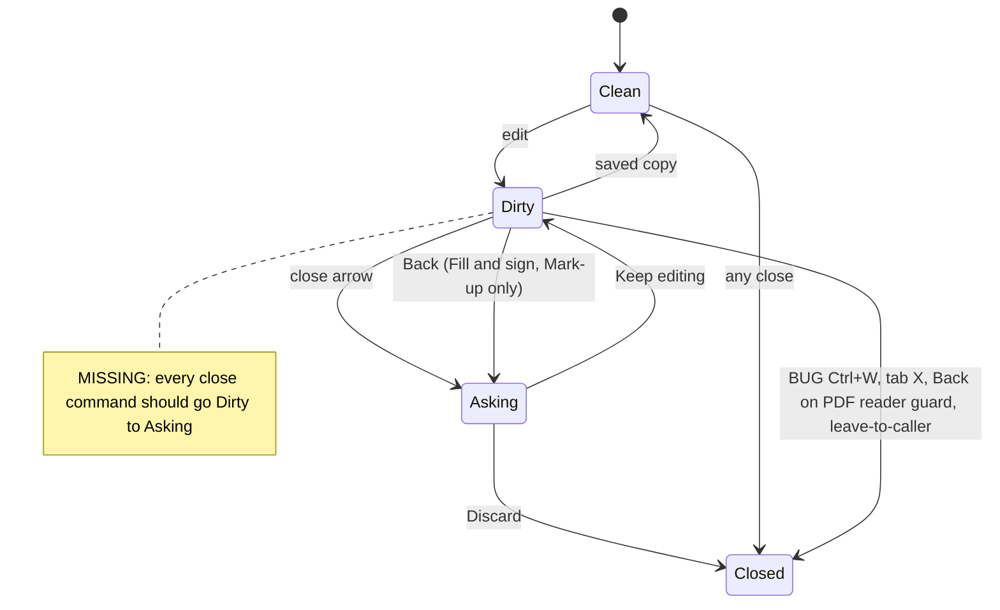

**After the fix.** The leave-guard registry (`src/state/leave.ts`). Every way out asks the guards in the scopes it takes away.

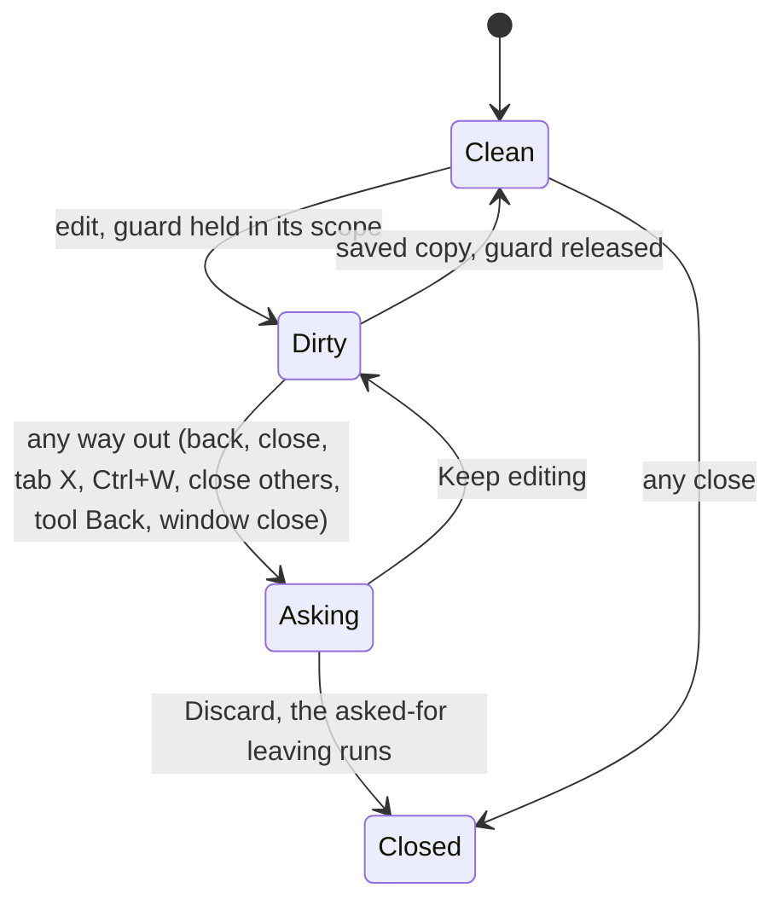

---

### SM-02: Scan pages: Save while a page is still being made — BUG NOW

**Status: fixed** in `4516ee8` (item 4.2, with SM-16). The page ref is updated synchronously, so Save waits for finished pages; queued decode, detection and render work checks that the tool is still mounted and stops when it is not; active and queued render jobs close on unmount. Scan also holds a leave guard (`666dcfc`). Not changed: a decode already running finishes before the mounted check.

**Location.** `src/screens/tools/scan/ScanTool.tsx`:
- `83-85`: `pages` and `pagesRef`.
- `107-120`: `update` (a `setPages` updater).
- `123-156`: `renderNow` and `render` on the `queue` promise chain.
- `160-198`: `addMany`.
- `280-306`: `save`.
- `521-531`: the `Go` button, labelled "Finishing {n} page…" but not disabled while pages are working.

**Current form**
- Per page: `state: "working" | "ready" | "failed"` plus `version`. This part is good.
- Across pages: `queue` (a promise chain), `pagesRef` (updated at render), and `editing`.

**Real states (tool):** `Empty` → `Working(n)` → `AllReady` ↔ `Editing(page)` → `Saving` → `Saved | Failed`.

**The bug.** `save()` waits for the queue to settle (`:283-287`), then reads `pagesRef.current` (`:288`). The last `renderNow` calls `update()`, which is `setPages(updater)` from a promise continuation. Under `createRoot` (React 18.3, `src/main.tsx:46`) that update is scheduled at default priority and rendered in a later task. The `await before` continuation in `save()` runs in the same microtask checkpoint, before React has rendered, so `pagesRef.current` still holds the page as `"working"` without `jpeg`. `:289-290` then throws `"pages not ready"`, and `useRun` shows "Couldn't save a copy".

**Reproduction.** Choose one photo and finish the editor. The page tile shows the working spinner, and the button reads "Finishing 1 page…" and is enabled. Press it. The queue finishes, the check reads the stale ref, and the error toast appears. Pressing Save again a moment later works.

**Missing transitions**
- **Unmount mid-flight.** Leaving the Scan tool does not stop the queue. With "Choose photos" of 50 pictures, every remaining photo is still decoded, its page found and its page rendered in workers after the screen is gone (`:178-195`). That costs CPU, memory and battery on a phone. The `update()` calls are dropped by React, so there is no leak of object URLs.
- There is no cancel for a running batch.

**Races.** Covered by the version check for re-edits (good).

**Performance.** As above: wasted work after unmount.

**User-visible states.** The per-page spinner and "Couldn't make this page", the "Finishing…" label, and the save error.

**Lightest fix**
- Let `update` also write `pagesRef.current` synchronously (compute the next list, assign the ref, then `setPages(next)`), or have `renderNow` return the finished page data and build the PDF from that.
- Hold an `AbortController` for the queue and abort it in the unmount effect (`:220-226`), checking `signal.aborted` before each decode or render.

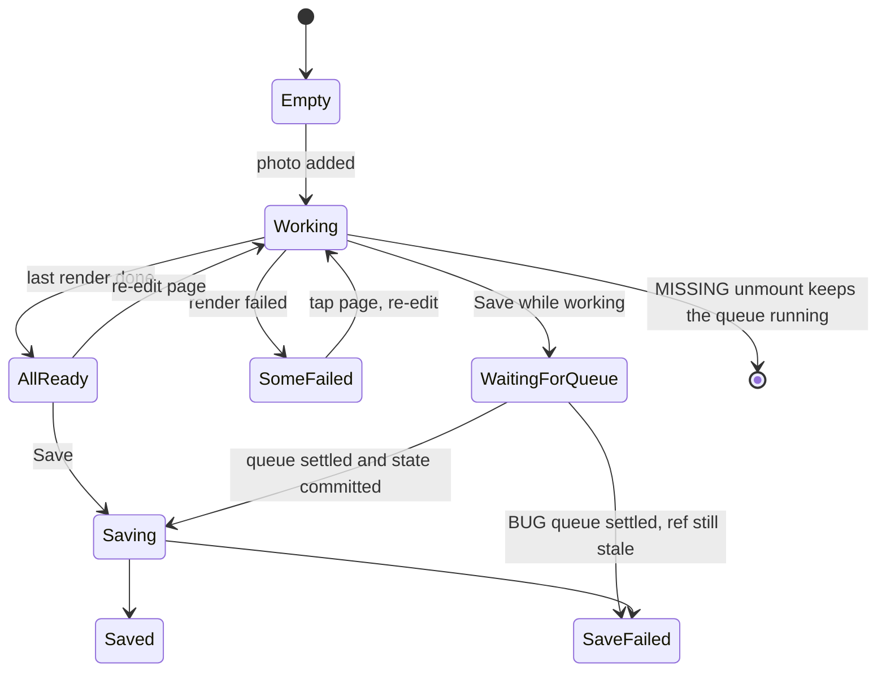

---

### SM-03: Recents store: Undo window, pre-ready writes, focus refresh — BUG NOW

**Status: fixed** in `1062171` (item 4.3, with X-02 and X-19). A change asked for before the stored list is read is held and made on the list as stored. A focus-refresh read that a local change overtook is dropped and read again after that change's write. The release of managed copies and Android URI grants follows the Undo message (toast `onExpire`), not a 6 s timer; callers with no Undo release at once; recents turned off from another window keep the 6 s timer. A toast with an action steps aside for a newer message and comes back with the time it had left (at least 2.5 s), at most two waiting. Confirm on a phone with TalkBack.

**Location**
- `src/state/recents.tsx`:
  - `88-101`: `entries`, `ready`, `current` ref, `apply`.
  - `103-120`: the `writing` chain and focus refresh.
  - `126-162`: `commit`, including the undo release timer `UNDO_MS = 6000` at `:55` and `:157`.
  - `164-190`: load.
  - `228-238`: `record`.
  - `266-295`: `remove`, `clear`, `restore`.
- Callers: `src/screens/home/Home.tsx:677-688` (Remove + Undo toast) and `viewer/ViewerScreen.tsx:219-231` (`record`).
- Toast lifetime: `src/ui/Overlay.tsx:600-608`. The toast is held while hovered or focused, `:626-629`.

**Current form**
- `entries` (state), `current` (ref, the source of truth).
- `ready` (boolean); mutations do not consult it.
- A `writing` chain used for SHARED (desktop) writes and refreshes.
- One `setTimeout(release, 6000)` per undoable change.
- A separate toast timer of 6000 ms that pauses while the toast is held.

**Real states:** `Loading` → `Ready`. Per undoable change: `Removed(undoable)` → (`Restored` | `Committed`, which releases the managed copies and Android URI grants).

**Bug (Undo window kept by two independent timers)**
- The managed copy and the URI grant are released at a fixed 6 s after the remove (`:157`, `:150-156` → `importsRemove`, `releaseDocument`).
- The Undo toast stays up for as long as it is held (pointer over it, or keyboard or accessibility focus on it).

**Reproduction (Android).**
1. Open a file shared into Paperwren ("Open with"). It becomes a `managed` entry via `requestForManagedCopy` (`App.tsx:447`).
2. On Home, open its menu and choose Remove from recents.
3. With TalkBack, focus moves onto the toast's Undo (or with a mouse or keyboard on a tablet or ChromeOS), and `held = true`.
4. Activate Undo after more than 6 s.
5. The entry is back in the list, but `release()` has already deleted its managed copy. Opening it fails with "not found" and marks it unavailable.

The same applies to Settings → clear recents (`clear` is undoable) and to a picked original whose persistable grant was released.

**Risks (not shown to happen)**
- **(a) Mutations before `ready`.** `record`, `markUnavailable` and `setPosition` run against `current.current = []` if they come before `load()` resolves.
  - On a phone (not SHARED), `commit` then writes `next` (a one-entry list) over the whole stored list (`:144`), and `load()` later shows the old list in the UI. The next launch shows a list of one.
  - It is reachable only if a viewer finishes reading a file before one `storeGet` returns. Root's open-with drain effect (`App.tsx:440-456`) runs before RecentsProvider's load effect, but the viewer still has to load its chunk and read the file.
- **(b) Focus refresh on desktop.** It is queued on the chain and then `apply(there)` overwrites `current`. A commit made after the refresh was queued, but before its read resolved, disappears from the UI until the next focus. The store still holds it.
- **(c) No rollback.** A failed write leaves the UI showing state the store does not have (`.catch(() => {})`).

**Duplicated logic.** The same "SHARED: read the store, apply, write" pattern exists in `state/bookmarks.ts` (SM-12), but without the chain.

**Performance.** `setPosition` goes through `commit` on every position save. Viewers debounce it (PDF 400 ms), but on a phone each save is a full-list `storeSet`.

**User-visible states.** The Recent files list, pins, the "unavailable" badge, and Undo.

**Lightest fix**
- A reducer with `{status:'loading', queued: Action[]} | {status:'ready', entries}`. Actions that arrive while loading are queued and replayed onto the loaded list.
- `toast()` takes an `onExpire` callback. `remove` and `clear` pass the release there instead of a fixed timer (release on expiry or on dismiss, never while held).
- Route focus refresh and writes through one queue that drops a refresh result older than the last local commit.

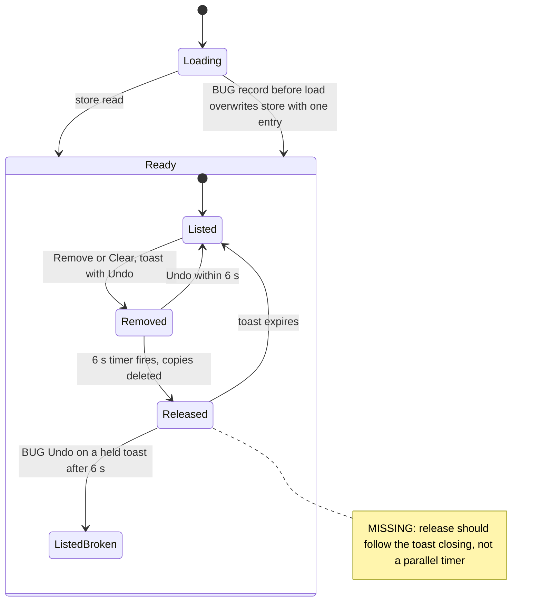

**After the fix.** Recents lifetime: held changes, remove, undo and settle.

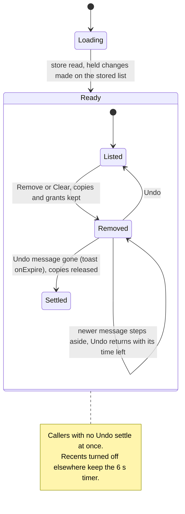

---

### SM-04: Fill & sign: signature target left behind in a ref — BUG NOW (low)

**Status: fixed** in `b60c6b1` (item 4.5). A toolbar signature choice clears any old field target, and forgetting the last signature clears it before the chooser closes.

**Location**
- `src/screens/tools/FillSign.tsx`:
  - `324-330`: `chooser`, `padFor`, `stampPad`, `chosen`, `chosenStamp`, and `target` (a ref).
  - `480-507`: `pick`.
  - `514-546`: `signWith`, which consumes `target`.
  - `547-554`: `signInto`, which sets `target`.
- Cancel paths: the chooser `onClose` (`:1050-1052`) and the pad `onClose` (`:1121-1124`).
- Forget: `:1079-1092`.

**Current form.** "What the next signature is for" (a tapped field, or a tool to place by hand) lives in a mutable ref. It is cleared by two of the exits from the chooser, but not by the third.

**Real states:** `Idle` → `ChoosingFor(field | tool)` → `DrawingFor(field | tool)` → `Placed | Placing(tool)`.

**Bug.** In the chooser, removing the last kept signature with the trash button runs `forgetSignature`, then `setChooser(null)` when no signatures are left (`:1086-1091`). `target.current` is not cleared. Later, the toolbar's Signature (or Initials) has no kept signatures, so `setPadFor(...)` runs. When that pad is done, `signWith` reads the stale `target.current` (`:518-519`) and drops the new signature into the field tapped earlier, instead of putting it in hand to place.

**Reproduction**
1. Have one kept signature, and tap a signature field. The chooser opens with `target` set.
2. Tap the trash icon. The chooser closes.
3. Scroll to another page and tap toolbar → Signature. The pad opens.
4. Draw and tap Done. The signature is placed in the first field, possibly on another page.

With Initials (`pick("initials")`), the initials land sized into the signature field.

**Lightest fix.** Replace the ref and the four pieces of state with `placing: {for:'field', field} | {for:'tool', kind} | null` plus `dialog: 'chooser' | 'pad' | 'stampPad' | 'save' | 'leave' | null`, and clear `placing` on every dialog exit.

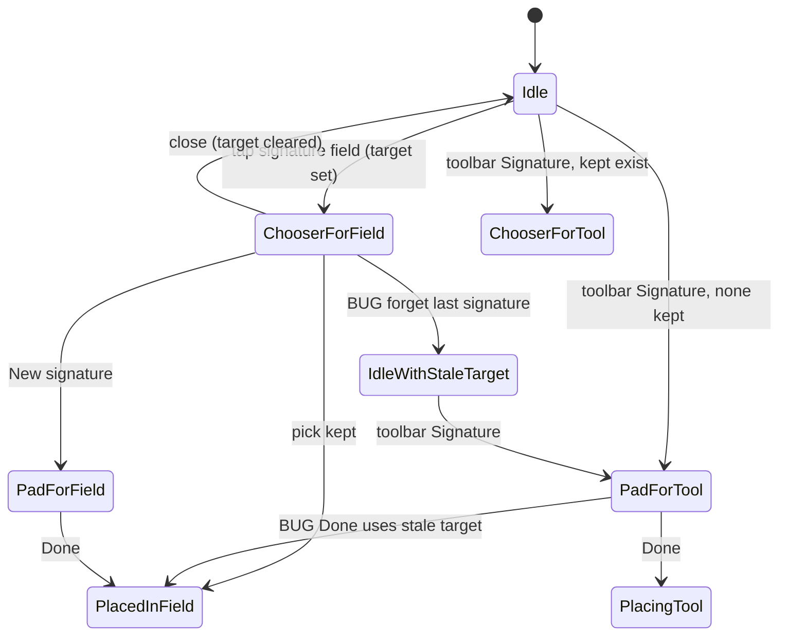

---

### SM-05: Read aloud: a piece fetched for a run that was superseded is dropped — BUG NOW (low)

**Status: fixed** in `b60c6b1` (item 4.5). A piece fetched for a superseded run goes back behind the pieces Back queued, so pause or skip during extraction no longer drops a sentence.

**Location.** `src/screens/viewer/ReadAloud.tsx`:
- `36-41`: `flow`, `behind`, `ahead`, `now`, `run`.
- `43-49`: `next()`.
- `59-91`: the `read()` loop.
- `114-138`: `pause`, `resume`, `forward`, `back`.
- PDF source: `viewer/speechSources.ts:173-192`, which awaits `getPage` and `getTextContent` per page.

**Current form.** A run token (`run`) plus four refs that form a cursor over an async generator.

**Real states:** `Speaking(piece)` → `Fetching` → `Speaking(next)` … `Paused(at piece)` → `Speaking` … `Ended`.

**Bug.** `read()` does `current = await next()` (`:85`) and then loops while `mine === run.current`. If Pause, Forward or Back bumps `run` while `next()` is pending, the piece `next()` returns is discarded. It is never put back in `ahead`, and `now.current` still points to the piece already spoken.

**Reproduction**
1. Read a PDF aloud, and press Pause as the last sentence of a page ends, while the next page's text is being extracted (tens to hundreds of ms).
2. Press Play. `resume()` calls `read(now.current)`, which speaks the last sentence again. Then `next()` returns the second piece of the new page, so the first piece of that page is never spoken.

**Lightest fix.** In `read()`, when `mine !== run.current` after an `await next()`, push the fetched piece back onto `ahead`. A small reducer over a `{behind, now, ahead}` cursor would make this explicit.

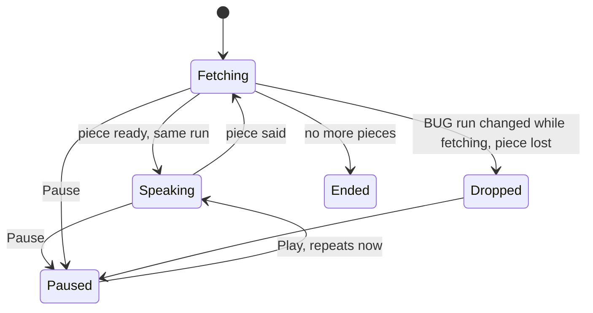

---

### SM-06: Compress tool: result text not tied to the file it describes — BUG NOW (low)

**Status: fixed** in `b60c6b1` (item 4.5). Outcome, progress and the oversize offer are cleared when the selected file changes.

**Location**
- `src/screens/tools/ToolsScreen.tsx`:
  - `593-615`: `way`, `typed`, `unit`, `grey`, `outcome`, `progress`, and `tooBig`, which is keyed `of: picked.key`.
  - `628-698`: `compress`.
  - `842-846`: `outcome` rendered without checking `picked`.
- `useRun` feedback: `tools/kit.tsx:362-419`.
- File removal: `kit.tsx:229-230`, available while a run is not busy (`FileList` `:309-315`).

**Current form.** Three result-ish strings plus `useRun`'s `running`, `result` and `error`. Only `tooBig` remembers which file it is about.

**Bug.**
1. Compress file A. The outcome reads "2.4 MB down to 610 KB, 75% smaller".
2. Remove A and choose file B.
3. The outcome still shows A's numbers under B, until a setting is changed (`choose()` clears it).

The useRun "Saved as A compressed.pdf" line also stays. It is less misleading, since that file exists.

**Lightest fix.** Reset `outcome` and `progress` in an effect keyed by `picked?.key` (as OrganizeTool does at `:1024-1027`), or keep them as `{of: key, text}` like `tooBig`.

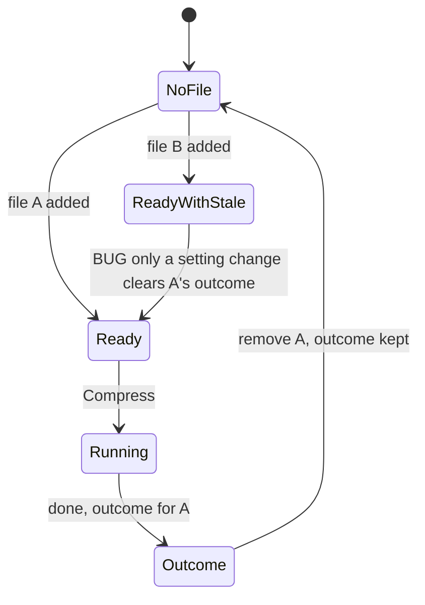

---

### SM-07: Who owns the keyboard: zoom and undo keys reach a document under a modal tool — BUG NOW (low)

**Status: fixed** in `666dcfc` (item 4.1). `ownsKeys(depth)` in `src/ui/Overlay.tsx` is the one keyboard-owner check. Ctrl+O and Ctrl+W act only with nothing over the app; the viewer zoom keys no longer reach a document under Fill and sign or Mark up; Mark up's Ctrl+Z and Ctrl+Y stop while its Save or Leave question is open. Later handlers (the browser-key guard, `f1a16d3`) use it too.

**Location**
- `src/screens/viewer/hooks.ts:418-434` (`useZoom` keydown: checks `enabled` and `active` only).
- `src/screens/tools/MarkUp.tsx:258-271` (Ctrl+Z and Ctrl+Y: no modal check).
- `src/App.tsx:515-601` (Ctrl+O and Ctrl+W: no `modalOpen()`).
- For contrast: `Shell.tsx:445-456`, `:487-496`, `:775-787` and `PdfView.tsx:1539-1552` all check `modalOpen()`.

**Current form.** A global modal depth counter (`Overlay.tsx:21-28`) that each handler may or may not consult.

**Bug.**
1. Open a PDF on a desktop and choose Fill & sign (a full-screen modal; the viewer stays `active`).
2. Press Ctrl+=. PdfView's `useZoom` key handler zooms the PDF behind the editor (FillSign has no zoom keys of its own).
3. On closing Fill & sign, the reader finds the document at 125%.

Ctrl+Z inside Mark-up also acts while its Save or Leave dialog is open. That is harmless, because the save takes `items` at click time. Ctrl+W is the serious case and is part of SM-01.

**Lightest fix.** Gate every window-level keydown on "nothing modal above me" (`modalOpen()`), or route keys to the topmost overlay first and stop propagation there.

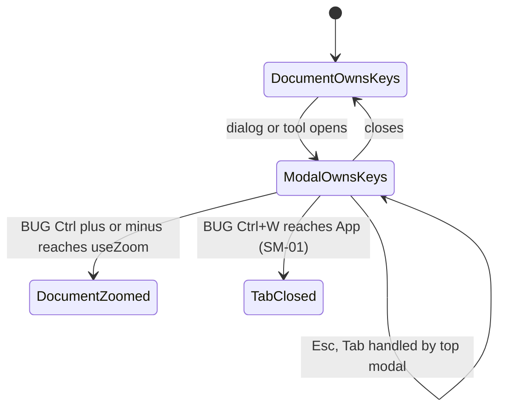

---

### SM-08: Desktop tabs, split view and the nav stack — BUG RISK

**Status: not changed** by this project. The risk stands as described.

**Location**
- `src/App.tsx`:
  - `144-165`: `tabs`, `tabsRef`, `used`, `leaving`, `split`, `splitRef`, `besideOf`, `room`, `width`.
  - `167-295`: `show`, `closeTab`, `goHome`, `moveTabTo`, `closeAround`, `open`, `replaceTab`, `renamedOpen`.
  - `297-311`: the effect "Back took the document away closes its tab".
  - `316-337`: `pick`, `picking`.
  - `339-394`: `sideBySide`, `paneOf`.
  - `780-788`: which tabs stay mounted.

**Current form.** Tab list (state plus mirror ref), MRU order (a ref read during render), a one-shot `leaving` flag that tells the effect whether a nav change was a tab switch or a Back, split (state plus ref), and `besideOf` (a ref consumed by the next `open`).

**Real states:** `Home(tabs)`, `Showing(tab)`, `Split(left, right, focused)`, `OverOther(Settings|Tools|Notes, tab behind)`, `PickingBeside(tab)`.

**Invalid states the code allows or depends on**
- **`besideOf` set while the picker is open.** Any other `open()` consumes it. For example, a second launch hands over a file (`onOpenFiles` → `openGiven` → `open`) while the Open-beside picker is up. That file becomes the right half, and the picked file then opens as an ordinary tab.
- **`leaving` is a single boolean** consumed by the next effect run. Correctness relies on every `reset()` producing a new `state.screens` (true today: `navReducer` "reset" always returns new arrays).
- **`used` is mutated in callbacks and read during render** (`:787`). It is correct only because every mutation is followed by a state update in the same handler.
- **`closeAround`** calls `show(keep)` and then `closeTab()` for each tab, while `stateRef` is stale (the reset is not rendered yet). It works because `closeTab` re-picks `keep` from `used`.

**Missing transitions.** None found. The risk is that every new tab feature has to keep five variables in step.

**Races.** The `besideOf` hand-off above.

**Performance.** `sideBySide` is rebuilt on every `tabs` change. Fine.

**User-visible states.** The tab strip, the split divider, and which tab is shown after a close.

**Lightest fix.** A reducer `{tabs, mru, split, beside, shown}` with typed actions. Nav `reset` becomes an effect of the reducer's `shown`, and "Back popped a viewer" becomes an action fed from the nav provider instead of a `leaving` flag.

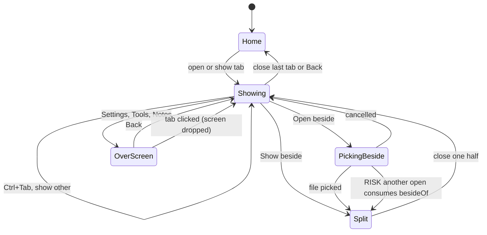

---

### SM-09: Viewer open pipeline — BUG RISK

**Status: not changed** by this project. The risk stands as described.

**Location**
- `src/screens/viewer/ViewerScreen.tsx`:
  - `183-207`: `loaded`, `failure`, `allowed`, `initialPosition`, `reads`, `locked{data,wrong,busy}`, `unlocking`, `firstOpen`.
  - `212-232`: `show` (sniff, record, `setLoaded`).
  - `234-254`: `unlock`.
  - `256-285`: the read effect.
  - `292-298`: `reload`.
  - `312-391`: the render ladder.
- `src/App.tsx:284-295`: `renamedOpen` replaces `tab.request` in place under the same key.
- `src/screens/home/Home.tsx:695-702`.

**Current form.** Five pieces of state whose combinations are read top-down: `failure` wins, then `!allowed`, then `locked && !busy`, then `!loaded`.

**Real states:** `NeedsConsent` → `Reading` → (`Locked` ↔ `Unlocking`) → `Loaded` → `Reloading` → `Loaded`, and from anywhere → `Failed` (terminal).

**Invalid states and risks**
- **`request` changes in place** (Home rename of a file open in a tab) without resetting `loaded`, `failure`, `allowed` or `initialPosition`. The effect at `:256-285` re-reads the file, and `show()` hands new `data` to the same mounted engine (see SM-10 for PDF):
  - `record()` runs again, bumping `openedAt`, so the renamed file jumps to the top of Recent files while the reader is looking at Home.
  - A failed re-read raises the error dialog (portalled) over Home for a hidden tab.
  - The whole file is read and parsed again for a rename (wasted work).
- `firstOpen` is computed from the `entries` captured by the effect closure. Before recents are ready it is `true` for an old file, so a later `onBroken` would remove a long-standing entry (ties to SM-03 a).
- The `unlocking` controller is overwritten without aborting the previous one (`:238`). It is unreachable today, because the dialog is hidden while busy.

**Missing transitions.** Retry from `Failed` (the dialog only offers close, remove or locate). This is intentional.

**User-visible states.** The large-file dialog, the password dialog, the opening view, the error dialog, the viewer crash boundary, and the file-changed bar.

**Lightest fix.**
- `type Phase = {k:'consent'} | {k:'reading', n} | {k:'locked', data, wrong} | {k:'unlocking', data} | {k:'loaded', ...Loaded} | {k:'failed', failure}`.
- In App, key `ViewerScreen` by `tab.key + request.reopen` identity so a rename remounts cleanly, or have `renamedOpen` update only the name and reopen without triggering a re-read.

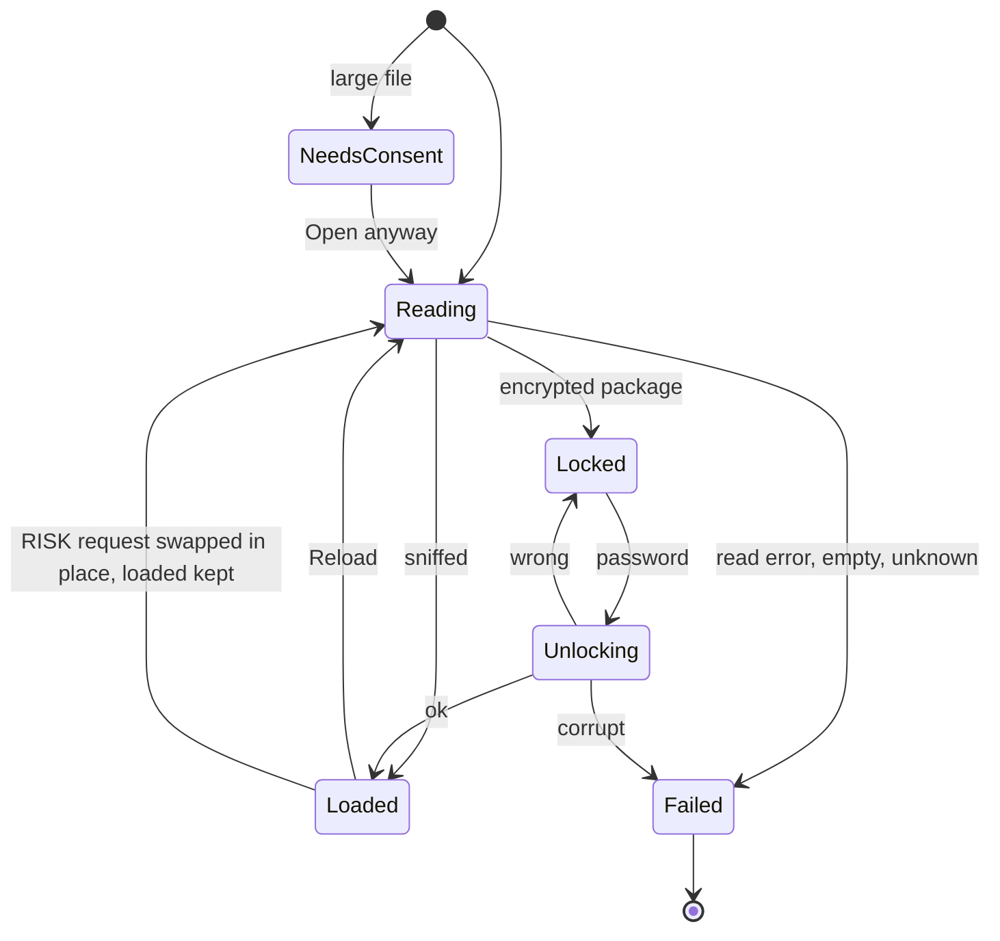

---

### SM-10: PDF document lifecycle — BUG RISK

**Status: fixed** in `ddcb4c9`. Loading replacement bytes clears the destroyed proxy, the earlier error, the password and the document metadata. Empty input goes through the ordinary failure path, and late outline and signature-save completions are ignored. The viewer also releases its document on close (`255dd80`, B-1), which is the memory side of the same lifecycle.

**Location.** `src/screens/viewer/PdfView.tsx`:
- `279-285`: `doc`, `status: "loading"|"ready"|"password"|"error"`, `fault`, `passwordWrong`.
- `456-598`: the load effect on `[data]`.
- `601-866`: the viewer mount on `[doc]`.
- `2399-2416`: the loading and error views.
- `2455-2466`: the password dialog and `unlock`.

**Current form.** A good `status` union, but `doc`, `fault` and `passwordWrong` sit beside it instead of in it.

**Invalid states**
- **`status === "loading"` with a destroyed `doc`.** When `data` changes (SM-09 swap), the cleanup destroys the loading task and therefore the old document (`:587-597`). `doc` is never set to null, so the mounted `PDFViewer` (effect keyed on `doc`) keeps rendering from a destroyed proxy until the new `setDoc`.
- **`status === "error"` for an empty buffer** (`:469-471`) sets neither `fault` nor calls `onBroken`, unlike the catch path. It is unreachable today, because the Viewer rejects empty files first.
- **`passwordRef`** keeps the last *submitted* password, even a wrong one. It is fine, because it is overwritten on each submit and only read on success.

**Missing transitions.** The password dialog's Cancel closes the whole viewer (intended).

**Lightest fix.** `type Doc = {k:'loading'} | {k:'password', wrong, answer} | {k:'ready', doc, password?} | {k:'error', fault}`, reset to `loading` (and the old doc dropped) in the `[data]` effect.

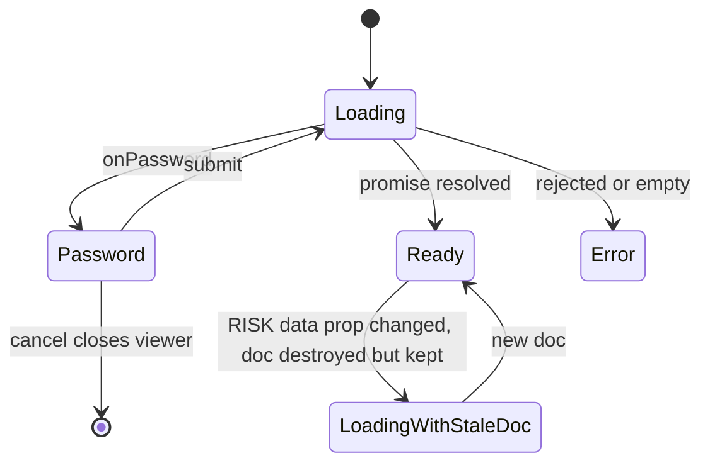

---

### SM-11: Settings store — BUG RISK

**Status: fixed** in `9f3b006` on the helper `8f96266` (item 4.4, M-4). Settings is one stored value (`src/lib/storedValue.ts`). `update()` before the first read waits for it; the write is no longer made inside a state updater; ten slider steps make one write, 250 ms after the last; a desktop write is made onto the settings as stored then; the focus refresh no longer drops a change made meanwhile.

**Location.** `src/state/settings.tsx`:
- `67-85`: `settings`, `ready`, load.
- `91-104`: focus refresh (desktop).
- `153-162`: `update`, which calls `backend.storeSet` inside the `setSettings` updater.

**Risks**
- **`update()` before `ready`** writes `{...DEFAULT_SETTINGS, [key]: value}` over the stored settings. When load resolves, the UI shows the stored values and loses the user's change, while storage has defaults plus one key. The only early callers are Onboarding (`Onboarding.tsx:70`, theme) and anything else mounted before load; the welcome waits for a separate `storeGet`, so it is a narrow window.
- **The side effect inside a state updater.** StrictMode (dev) runs updaters twice, so there are two writes. A future concurrent re-render could also replay it.
- **Focus refresh** can replace a change made between the refresh's read and its answer. Recents chains its refresh behind writes; settings does not.

**Lightest fix.** Hold writes in a queue until `ready`, write from the action (not the updater), and serialize refresh after pending writes.

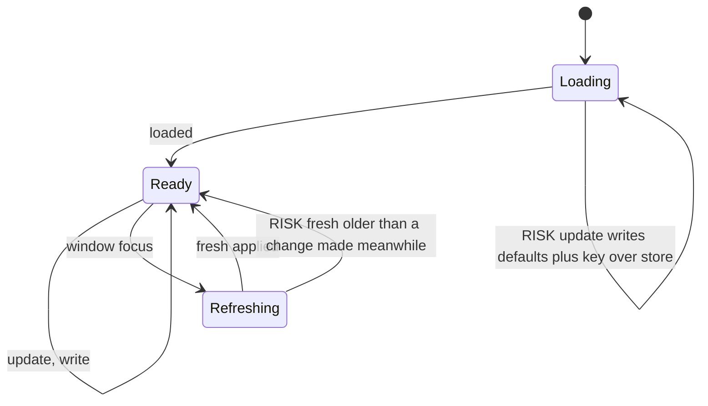

**After the fix.** Every stored value now follows this shape (`createStoredValue`, `src/lib/storedValue.ts`): settings, bookmarks, saved folders, kept signatures and stamps, and each document's marks.

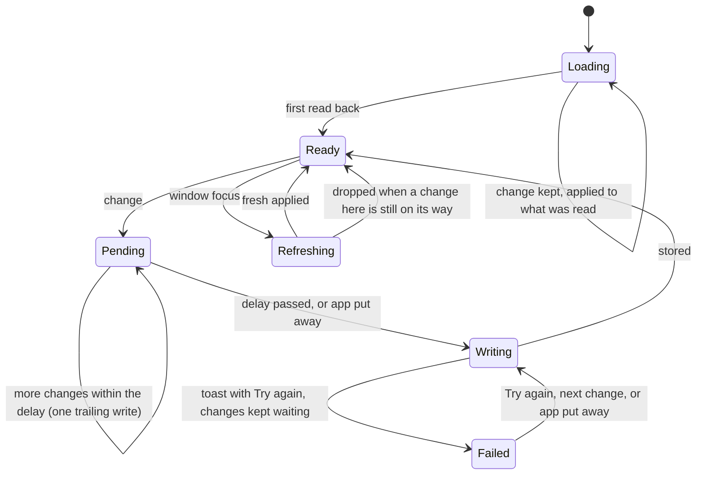

---

### SM-12: Bookmarks store — BUG RISK

**Status: fixed** in `9f3b006` (item 4.4). Bookmarks are one stored value, so changes go one after another and each starts from the list as it is then. Clearing and its Undo write at once and fail as a whole.

**Location.** `src/state/bookmarks.ts:22-80` (module-level `book`, `loading`, and `change`, `moveBookmarks`, `clearBookmarks`, `restoreBookmarks`).

**Current form.** Module-level state. Each mutation awaits `load()`, then on desktop re-reads the store (`SHARED`), applies its edit to what it read, and writes. Mutations are not chained.

**Risk.** Two mutations whose reads overlap both start from the same base, so the second write erases the first. That applies both in memory (`book = next`) and in the store. Examples: two quick adds (Ctrl+D twice inside one IPC round trip), or an add racing `moveBookmarks` after a rename. The window is the `storeGet` latency (milliseconds), so I could not show a human-speed sequence.

**Lightest fix.** `let chain = Promise.resolve()`. Every mutation goes on `chain = chain.then(...)`, exactly as `recents.tsx:132-143` already does.

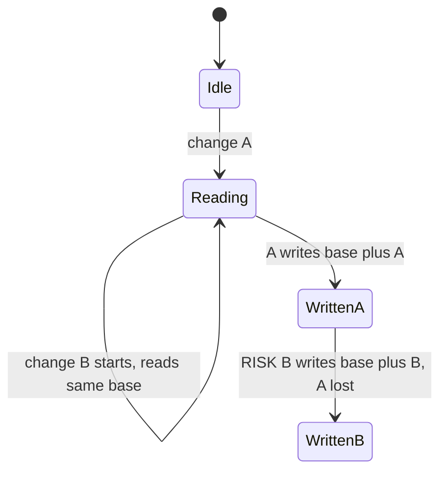

**After the fix.** Bookmarks use the stored-value shape of SM-11: changes are queued, so two quick adds both land.

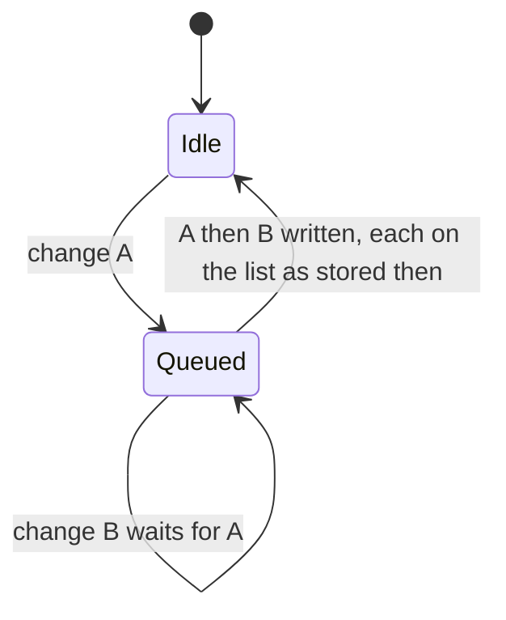

---

### SM-13: Saved folders — BUG RISK (low)

**Status: fixed** in `9f3b006` (item 4.4). Saved folders have a read gate, and `add()` reads the list as it is after the picker returns.

**Location.** `src/state/folders.ts:29-77`.

**Risks**
- There is no `ready` flag. `save()` before the initial `storeGet` resolves writes a list built from `[]`.
- `add()` reads `folders` from its closure after `await backend.pickFolder()`. Nothing else can change folders while a native picker is open, so this is low.

**Lightest fix.** Add a `ready` gate and use `setFolders(prev => …)` after the await.

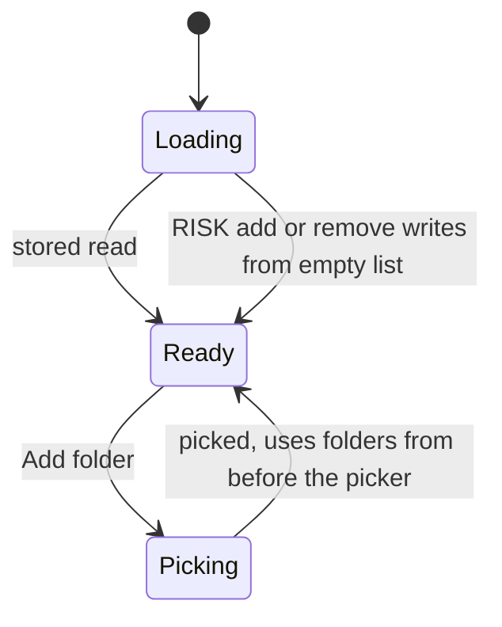

**After the fix.** Saved folders use the stored-value shape of SM-11.

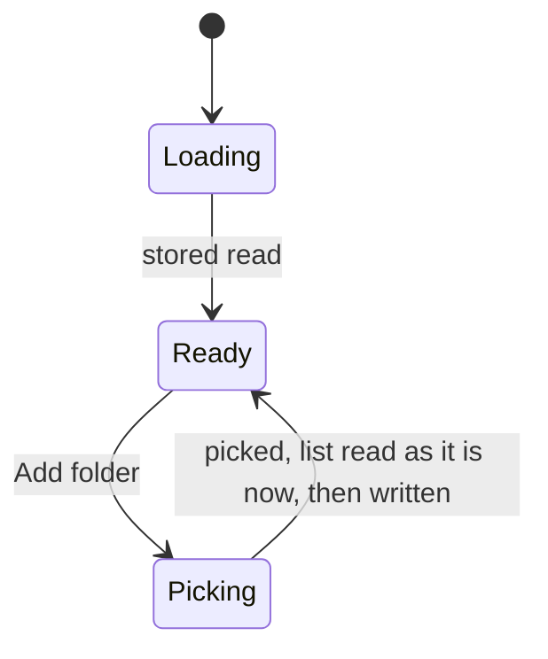

---

### SM-14: Document marks store — BUG RISK

**Status: fixed** in `9f3b006` (item 4.4, X-03). Nothing is written before the marks are read; a mark made sooner is added to them and written with them (no editor gate was needed, so `PdfView.tsx` was not touched). The write for the document left is made in an effect, not during render. A failed write keeps the marks unsaved and says so, with Try again.

**Location**
- `src/screens/viewer/useDocMarks.ts`:
  - `46-56`: `list`, `note`, `scales`, `ready`, `steps`, `past` and `future` refs, the `current` ref, `unsaved`, `timer`.
  - `58-80`: `flush`, which is called **during render** when the key changes.
  - `88-111`: load.
  - `116-153`: follow-on-focus and watch.
- Editors not gated on `ready`: `ToolsScreen.tsx:514-546` (MarkUpTool opens on `doc` only) and `PdfView.tsx:2418-2430` (opens on `markingUp && doc`). The reading-marks layer is gated (`PdfView.tsx:2382`).

**Risks**
- A mark made before `loadMarks` resolves is flushed 250 ms later as the whole list, overwriting what was stored. Then `loadMarks` either wipes it from the UI or returns only it. It needs a stroke within one store read of the editor opening, so it is unlikely.
- `flush()` during render is a side effect that React may run for a render it then discards.

**Lightest fix.** Gate the editors on `store.ready`, and move the key-change flush into an effect cleanup keyed on `key`.

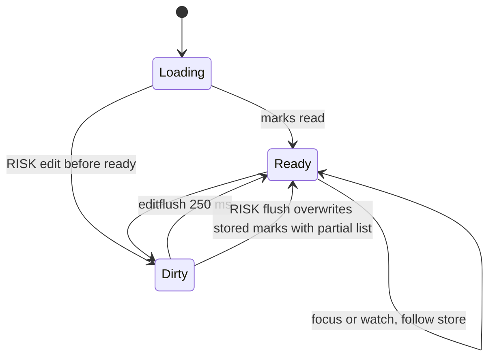

**After the fix.** Document marks use the stored-value shape of SM-11; a failed write is said.

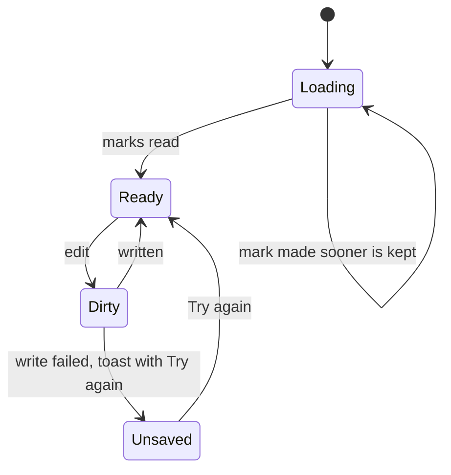

---

### SM-15: OCR engine and Read text — BUG RISK

**Status: fixed** in `1d9da3a`. A worker-wide failure terminates the worker and rejects start-up and every waiting read. Stored OCR that loads late is ignored once Start has been pressed. Real OCR language assets were not exercised.

**Location**
- `src/lib/ocr.ts:250-329`: `OcrReader` with `worker`, `waiting`, `ready`, `refuse`, `stopped`, `watcher`.
- `src/screens/tools/ReadText.tsx`:
  - `96-119`: `phase "ready"|"reading"|"done"` plus `working`, `share`, `loading`, `picture`, `lit`, `saving`, and the `reader` and `alive` refs.
  - `139-156`: `loadRead`.
  - `212-277`: `run`.

**Current form.** The screen has a good `Phase` union. The engine's lifecycle is implicit across nullable fields.

**Risks / missing transitions**
- **Worker death after `ready`.** `worker.onerror` only calls the start promise's `fail`, which has already settled. Reads in `waiting` never settle, and the screen stays on "Reading page n of m" with the spinner until the reader presses Stop. A WASM trap inside `Recognize` is caught in the worker and answered (`ocrWorker.ts:113-117`), so this needs the worker itself to die (for example, the OS killing it for memory on a phone). There is also no timeout.
- **`loadRead` resolving after Start was pressed** (`:144-152`) sets `reads` and `phase = "done"` in the middle of a run. The loop keeps going, but the UI shows done.
- `ready` is memoized, so a reader whose start failed never retries. That is fine today, since each run makes a new reader.

**Lightest fix**
- In `onmessage`/`onerror` after `ready`, fail every `waiting` entry and null the worker.
- In the `loadRead` effect, skip the update when `phase !== "ready"` (use a ref).

```mermaid
stateDiagram-v2
    [*] --> Ready
    Ready --> Done: earlier reads loaded
    Ready --> Starting: Start reading
    Starting --> Reading: engine ready
    Starting --> Done: start failed, toast
    Reading --> Reading: page read
    Reading --> Done: all pages or Stop
    Reading --> Stuck: RISK worker died, reads never settle
    Reading --> Done: RISK late loadRead sets done mid run
    Done --> Ready: language changed
```

---

### SM-16: Scan worker job — BUG RISK (low)

**Status: fixed** in `4516ee8` (item 4.2). `ScanJob.close` rejects its current request and queued requests reject when they reach the closed worker.

**Location.** `src/lib/scan/job.ts:92-160` (`ScanJob.send` chain; `close()` terminates the worker). `ScanEditor.tsx:197-202` closes the job on unmount.

**Risk.** `close()` terminates the worker without rejecting the request in flight or those queued behind it, so their promises never settle. Today every caller is either unmounted (and ignores the result) or calls `close()` after its own await. Any future caller that awaits after another closes the job hangs silently.

**Lightest fix.** Keep the current request's `reject`, and call it (and the queued ones) in `close()`.

```mermaid
stateDiagram-v2
    [*] --> Loaded
    Loaded --> Busy: looks or render
    Busy --> Loaded: answer
    Busy --> Closed: close
    Closed --> [*]
    note right of Closed
        MISSING: pending promises are never rejected
    end note
```

---

### SM-17: Updater install — BUG RISK

**Status: fixed** in `b60c6b1` (item 4.5). The updater options bound the feed request to 30 s and the download to 5 minutes, using the plugin's own cancellation. A hang in the native installer or relaunch is not covered; confirm on a release build.

**Location**
- `src/lib/updates.ts:14-24` (union, good) and `:84-113` (`installUpdate`).
- `src/screens/Updates.tsx:83-121`: the dialog cannot be closed while `installing` (`onClose` returns, and both buttons are disabled), and the app is inert under it.
- `:40-44`: `install-failed` → toast → `dismissUpdate()`.

**Missing transitions**
- **`installing` has no timeout and no way out.** `check()` is called without options (`updates.ts:49-50`), so the plugin's download has no timeout set here. If the download stalls (network drops mid-file), the modal shows "Downloading the update: 43%" indefinitely, and the reader has to quit the app to use it. Whether the plugin's HTTP client has its own timeout I could not confirm from this repo.
- **`install-failed` goes straight to `idle`.** The version found is kept in `found`, but nothing offers to try again until the next check.

**Lightest fix.** Wrap `downloadAndInstall` in a race with a generous timeout that moves to `install-failed`, or let "Later" hide the dialog while the download continues in the background.

```mermaid
stateDiagram-v2
    [*] --> Idle
    Idle --> Checking
    Checking --> Available
    Checking --> Idle: quiet, none or failed
    Checking --> Latest: asked, none
    Checking --> Failed: asked, error
    Available --> Idle: Later
    Available --> Installing: Install and restart
    Installing --> Restarting: done
    Installing --> InstallFailed: error
    InstallFailed --> Idle: toast
    Installing --> Installing: RISK stalled download, dialog cannot close
```

---

### SM-18: Full screen hold for the slide show — BUG RISK (low)

**Status: not changed** by this project. The risk stands as described.

**Location.** `src/lib/fullscreen.ts`:
- `89-99`: module-level `windowFull`, `held`, `control`.
- `246-254`: `toggleFullscreen`.
- `269-282`: `holdFullscreen`.
- `318-339`: `windowFull` is updated only when `isFullscreen()` answers after a resize.

**Current form.** A queue of changes (good) plus module flags that describe the window as last *observed*, not as *requested*.

**Risk**
1. Press F11, then start the slide show before the window has resized and answered. `held` is false, so the toggle is queued; `windowFull` is still false.
2. `holdFullscreen` sees `windowFull === false`, so it sets `held = true` and queues `enter` (a no-op by then).
3. Ending the show runs `leave`, taking away the full screen the reader asked for with F11.

**Lightest fix.** Keep a synchronous `wanted: boolean` updated when a change is queued, and decide in `holdFullscreen` from `wanted`.

```mermaid
stateDiagram-v2
    [*] --> Windowed
    Windowed --> Changing: F11 or show start
    Changing --> Full: settled
    Changing --> Windowed: settled
    Full --> HeldByShow: RISK show starts during change, held set
    HeldByShow --> Windowed: show ends, leaves user's full screen
    Full --> Windowed: F11, Esc
```

---

### SM-19: Print guard — BUG RISK

**Status: fixed** in `4c82e18`. A second print request shows pending feedback instead of being dropped. The host fallback is 60 s and also listens for `afterprint`; listeners and timers are removed, and the print root clears in `finally`. Native print dialogs and WebKitGTK and Android printing need confirming.

**Location.** `src/lib/print.ts:68-135` (module `printing` flag; waits up to 10 minutes for the host's print screen, or 60 s for `afterprint`).

**Risk / missing feedback**
- While `printing` is true, every later Print (menu or Ctrl+P) returns silently (`:82`).
- On the host-print path, the wait ends only on a hidden → visible pair of visibility changes (`:103-118`). If a host shows its print UI without hiding the web view, the app ignores Print for 10 minutes with no message, and the print root keeps its laid-out copy for as long.

**Lightest fix.** Make `printing` observable (busy state on the menu item, or a toast "Already printing"). End it on the host's own callback where one exists, and use a shorter fallback.

```mermaid
stateDiagram-v2
    [*] --> Idle
    Idle --> Preparing: Print
    Preparing --> HostPrinting: host print
    Preparing --> WebPrinting: window.print
    HostPrinting --> Idle: app hidden then visible
    HostPrinting --> Idle: 10 min timer
    WebPrinting --> Idle: afterprint or 60 s
    HostPrinting --> HostPrinting: RISK Print pressed, ignored silently
```

---

### SM-20: File-changed watcher — BUG RISK (low)

**Status: fixed** in `b60c6b1` (item 4.5). Generation guards drop late base, dismiss and poll results across file or read changes and unmount. The audit's unhandled rejection could not be shown (the backend returns null on failure); the catches are defensive.

**Location.** `src/screens/viewer/FileChanged.tsx:18-67` (`base` ref `null | number`, `changed` state, `stamp()` promises).

**Risks**
- `stamp()` results are applied in arrival order, not request order. A `reopen` change followed by an older stamp resolving late sets `base` to the old file's time. A rename normally keeps the modified time, so this is low.
- `stamp().then` has no `.catch`. A rejected stamp is an unhandled rejection. Whether `raw.stamp` can reject, I did not confirm.

**Lightest fix.** A generation counter: apply a stamp only if it belongs to the current read, and add `.catch(() => {})`.

```mermaid
stateDiagram-v2
    [*] --> NoBase
    NoBase --> Watching: base stamp
    Watching --> Changed: newer stamp seen
    Changed --> Watching: dismiss, new base
    Changed --> NoBase: reload
    NoBase --> Watching: RISK late stamp of previous file becomes base
```

---

### SM-21: Signature pad Done — BUG RISK (low)

**Status: fixed** in `616eb28` (item 4.5, X-10). Done has a synchronous guard across the font and storage awaits, the button is disabled and `aria-busy` while pending, and a late placement after unmount is ignored. Kept-ink storage failures are now said (`9f3b006`).

**Location.** `src/screens/tools/SignaturePad.tsx`:
- `119-139`: `way` plus per-way state (`drawn`, `canRedo`, and the strokes refs; `typed`, `hand`; `raw`, `trim`, `read`, `depth`, `oneInk`).
- `309-322`: `done()` awaits `fonts.load` (typed) and `keepSignature`, with no in-flight guard.

**Risk.** A second tap on Done during the awaits calls `keepSignature` and `onDone` twice. FillSign's `signWith` then sets the tool twice (harmless) or, with a field target, places once and puts the second in hand.

**Lightest fix.** A `busy` ref or state around `done()`. Optionally a union per `way` so photo, typed and drawn state cannot mix.

```mermaid
stateDiagram-v2
    [*] --> Making
    Making --> Finishing: Done
    Finishing --> Finished: kept, onDone
    Finishing --> Finishing: RISK second Done, onDone twice
```

---

### SM-22: Engine load states, one shape per viewer — BUG RISK (low)

**Status: not changed** by this project. The risk stands as described.

**Location.** Each viewer models "parse the bytes" differently:

| Viewer | Location | Shape |
|---|---|---|
| PdfView | `PdfView.tsx:280-284` | `status` union + `fault` |
| DocxView | `DocxView.tsx:103-160` | `status` union |
| SlidesView | `SlidesView.tsx:682-720` | `deck \| null`, `error`, `fault`, `textOnly` |
| ReflowView | `ReflowView.tsx:112-124` | a `result` union |
| ImageView | `ImageView.tsx:115-183` | `pictures`, `url`, `natural`, `failed`, `fault` |
| ModelView | `ModelView.tsx:67` | `phase` |
| SheetView | `SheetView.tsx:195-230` | `error` string + sheets |

**Risk.** In SlidesView the `"failed" in result` branch (`:703-707`) sets the error without checking `abort.signal.aborted` (the success branch checks). With an in-place `data` swap (SM-09), a late failure of the old parse can show an error over the new deck. Each viewer also re-implements loading, error and empty UI.

**Lightest fix.** `useParsed<T>(data, parse)` returning `{k:'loading'} | {k:'ready', value:T} | {k:'failed', kind, fault}`, with abort handled once.

```mermaid
stateDiagram-v2
    [*] --> Loading
    Loading --> Ready
    Loading --> Failed
    Ready --> Loading: data changed
    Loading --> Failed: RISK stale parse of previous data fails late
```

---

### SM-23: Image view HEIC fallback — BUG RISK (low)

**Status: fixed** in `271301f` (item 1.2). The original and fallback picture URLs are owned by one effect, replaced URLs are revoked, and late decode results are ignored. The HEIC worker also ends after its last job (P-10).

**Location.** `src/screens/viewer/ImageView.tsx:185-200` (`drawElsewhere`, `decoding`, the `decoded` ref).

**Risk.** The system-decoded JPEG URL is created outside the page effect. It is never revoked (one leaked object URL per HEIC shown), and it is set without an `alive` check. HEIC is always a single picture, so it cannot land on the wrong page today; I checked `pictures.ts`.

**Lightest fix.** Do the fallback inside the `[pictures, shown]` effect so it shares the guard and the revoke.

```mermaid
stateDiagram-v2
    [*] --> Decoding
    Decoding --> Shown: img loads
    Decoding --> SystemDecode: img error, HEIC
    SystemDecode --> Shown: jpeg url set, never revoked
    SystemDecode --> Unshown: no decoder
    Decoding --> Damaged: other error
```

---

### SM-24: Tool file intake and password prompt — READABILITY ONLY

**Location.** `src/screens/tools/kit.tsx:62-93` (`usePassword`: a pending promise kept in state) and `:101-243` (`useToolFiles`: `files`, `busy`, `adding`, the `picking` ref).

**States:** `Empty` → `Adopting(file)` ↔ `AskingPassword(name, wrong)` → `Listed`. Multi-pick runs sequentially with `adding {done,total}`.

**Notes**
- Unmounting while the password dialog is open leaves `adopt` awaiting a promise that never settles. It is harmless, but it leaks the closure.
- `busy || adding !== null` is derived correctly.

**Lightest fix.** Leave as is. Optionally answer `null` from an unmount cleanup.

---

### SM-25: PDF view: which panel or tool is open — READABILITY ONLY

**Location.** `src/screens/viewer/PdfView.tsx:322-399` (`outlineOpen`, `thumbsOpen`, `marksOpen`, `extra`, `viewOpen`, `findOpen`, `resultsOpen`, `readingText`, `filling`, `markingUp`, `cropping`, `leaving`, `askSigned`, `printAsk`, `offer`/`refused`).

**Notes.** Mutual exclusion holds because the full-screen tools are modal (the app is inert and `modalOpen()` is true) and the openers live behind sheets that close first. Nothing forbids `filling && markingUp`; it just cannot be clicked. There are 52 `useState`s in one component, each change re-renders the whole reader.

**Lightest fix.** `tool: 'fill'|'markup'|'crop'|'read'|null` and `panel: 'outline'|'thumbs'|'marks'|'comments'|'attachments'|'layers'|null`. This would also give SM-01 one place to ask "is a tool open?".

---

### SM-26: Phone reading bars — READABILITY ONLY

**Location.** `src/screens/viewer/Shell.tsx`:
- `550-569`: `autoHidden`, `tapShows`, and an effect that flips `tapShows` when the viewer's `chromeHidden` toggles.
- `570-588`: scroll listener.
- `592-602`: `fullFrom` on entering or leaving immersive.
- `964-968`: `barsHidden` derived by parity (`chromeHidden !== tapShows || autoHidden`, or `chromeHidden === fullFrom`).

**States:** `Shown`, `HiddenByScroll`, `HiddenByTap`, `ImmersiveHidden`, `ImmersiveShown`.

**Notes.** It behaves correctly. Each tap after an auto-hide costs one extra render (the effect re-syncs), which is invisible. The parity encoding is the hard part to change.

**Lightest fix.** A small reducer in Shell with actions `scrollDown`, `scrollUp`, `tap`, `enterImmersive`, `leaveImmersive`. Viewers send `tap` instead of owning `chromeHidden`.

---

### SM-27: Back and Esc bookkeeping — READABILITY ONLY

**Location**
- `src/state/navigation.tsx:55-111`: the `closers` map, the `closing` set, the `closed` set with a 400 ms timer, `leaveRef`, and `armed` history.
- `src/ui/Overlay.tsx:21-28` and `:102-166`: the `modals` counter, the `leaving` counter with a 400 ms timer.

**Notes.** The reducer (`lib/navigation.ts`) is already explicit and good. The two "just closed, skip it for 400 ms" mechanisms are the same idea implemented twice, once for Back and once for Esc. They are correct as far as I can tell.

**Lightest fix.** Leave as is. One shared helper if either changes.

---

### SM-28: Mark-up editor sub-modes — READABILITY ONLY

**Location.** `src/screens/tools/MarkUp.tsx:168-196` (`tool`, `live`, `writing`, `measuring`, `settingScale`, `corners`, `askScale`, `saving` ask|busy, `leaving`).

**Notes.** `saving` is already a union, and the save dialog refuses Back and Esc while busy (`:1040-1060`). The measure sub-flow (`settingScale` → `askScale` → `setScales`) is spread over three variables but is short.

**Lightest fix.** Leave as is. The keyboard part is in SM-07.

---

### SM-29: Notes editor autosave — READABILITY ONLY

**Location.** `src/screens/notes/NotesScreen.tsx:265-385`.

**Notes.** It is well built:
- One `writing` chain, a `stored` and `latest` pair, a debounce timer, and rollback of `stored` on failure (`:283-301`).
- A flush on hide and on unmount.
- Delete waits for the pending write.

**Lightest fix.** Leave as is.

---

### SM-30: Rename dialog — READABILITY ONLY

**Location.** `src/screens/viewer/RenameDialog.tsx:19-73`.

**Notes.** `busy`, `error` and `stem` behave as pristine, busy and failed. Cancel or Esc while busy closes the dialog, but the completion still updates recents and the tab, which is consistent with the file having been renamed.

**Lightest fix.** Leave as is.

---

### SM-31: Already explicit machines (reference) — READABILITY ONLY

These already use a discriminated union or a reducer and are the model for the fixes above:
- `ScanEditor` `Phase` (`ScanEditor.tsx:53`, `100`).
- `UpdateState` (`updates.ts:14-24`).
- FolderList `Listing` (`FolderList.tsx:76-91`).
- `navReducer` (`lib/navigation.ts:43-82`).
- ReadText `Phase` (`ReadText.tsx:41`, `96`).
- DocxView `status` and ModelView `phase`.
- ScanTool page `state` with `version` (`ScanTool.tsx:38`, `46`).
- `useZoom`'s `Gesture.kind` (`hooks.ts:183-248`).

---

### SM-32: Rust core — READABILITY ONLY

**Location**
- `src-tauri/src/lib.rs:43-66` and `:157-160`: `Waiting` is a `Mutex<Vec<String>>` drained by `launch_files` (take-once). It pairs with `backend.ts:1056-1088`, which takes, listens and takes again.
- `store.rs:48-76`: atomic write through a temp file, fsync and rename. Writes are serialized on the web side (`backend.ts:1304`).
- `save.rs:57-80`: rename refuses an existing target.

**Notes**
- There are no status enums in the Rust core. The only hand-off state (`Waiting`) is take-once, so a file is never opened twice and none is lost when it arrives before the listener. That is good.
- `save::rename` is check-then-act: `to.exists()`, then `fs::rename`. `std::fs::rename` replaces an existing target on both Windows and Unix, so a file created in between would be overwritten. The window is microseconds. It is not a state machine issue, noted for completeness.

**Lightest fix.** Leave as is.

---

## 3. Cross-cutting patterns

1. **A single "can I leave?" gate.** SM-01 and SM-07 come from the same thing: modal and dirty state lives in each surface, and global commands (Ctrl+W, Ctrl+O, the tab X, Back on the reader) do not ask it. A navigation-level registry of leave guards, plus a keyboard-owner check shared by every window keydown, removes both and the three copies of the "Leave without saving?" dialog.

2. **Store-backed lists need a `ready` gate and one write queue.** Recents (SM-03), settings (SM-11), bookmarks (SM-12), folders (SM-13) and document marks (SM-14) each re-implement load, apply, write and refresh. Only recents serializes. A shared `createStoredValue(key, normalize)` would give all five the same guarantees:
   - A `loading → ready` gate that queues early mutations and replays them.
   - One promise chain for reads and writes.
   - A refresh dropped if a newer local change exists.
   - An optional rollback.

3. **Generation tokens for async results.** Many effects use `alive` flags, which are correct for unmount but not for *superseded* requests applied outside an effect (SM-05 read aloud, SM-20 stamps, SM-23 HEIC fallback, SM-22 SlidesView's failed branch). A tiny `useLatest()` or `requestId` helper (`const id = ++gen.current; … if (id !== gen.current) return`) covers both.

4. **Workers need cancellation that settles promises.** `runWorker` rejects on abort (good), but `ScanJob.close()` (SM-16) and `OcrReader` after `ready` (SM-15) can leave promises hanging, and the scan queue (SM-02) cannot be cancelled at all. One `WorkerClient` with `request(msg, signal)` that rejects pending work on `terminate`, error or abort fixes all three.

5. **Refs used as state.** `target` (SM-04), `besideOf` and `leaving` (SM-08), and `pagesRef` read after an await (SM-02) are values that change what happens next but are invisible to React. Each bug or risk above involves one being stale. Fold them into the state that owns the flow.

6. **"Undo" and "busy" windows kept by two clocks.** The release timer vs the held toast (SM-03), and the 10-minute print flag with no feedback (SM-19). Where a UI element represents a window of time, the element's own lifetime should end the window.

7. **In-place prop swaps.** `renamedOpen` keeps the tab key and swaps `request`, so every engine must cope with `data` changing under it. Most (SM-10, SM-22) were written for "once per document". Either remount on identity change, or make the rename not re-read.

## 4. What I did not get to

- **Not read in depth:** `Marking.tsx` (selection popup, note editing; `menu`, `noteFor`, `pictureBar` look mutually exclusive, untested), `SheetView.tsx` beyond its parse effect, `SlidesView.tsx` beyond load, `EpubView.tsx`, `TextView.tsx`, `ContactsView.tsx`, `PdfExtras.tsx`, `FindResults.tsx`, `useDomFind.ts` (looked fine at a glance: a 200 ms debounce and an `open` flag), `Corners.tsx` drag handling, `StampPad.tsx`, `Sketch.tsx`, and `ShortcutList.tsx` key recording.
- **Settings screen** (`Settings.tsx`): only its update-check button. The confirm-clear dialogs and counts were not traced.
- **`Home.tsx`**: only the rename and remove paths. Search, filter, sort and the long-press menu were not traced.
- **Android shell and iOS:** Kotlin and `index.html` bridges (`__paperwrenOpenFile`, the volume keys, `leaveToCaller`, print callbacks) were not read. Some timing claims (SM-19 visibility on Android print, SM-03 TalkBack focus holding the toast) depend on them.
- **Rust:** `open.rs`, `folder.rs`, `imports.rs` and `trace.rs` were skimmed for state only, not audited for correctness.
- **Tauri updater plugin internals** (whether its download has a default timeout, SM-17) were not checked, since that code is not in this repo.
- **Tests:** not read or run, as instructed. No finding relies on them.
